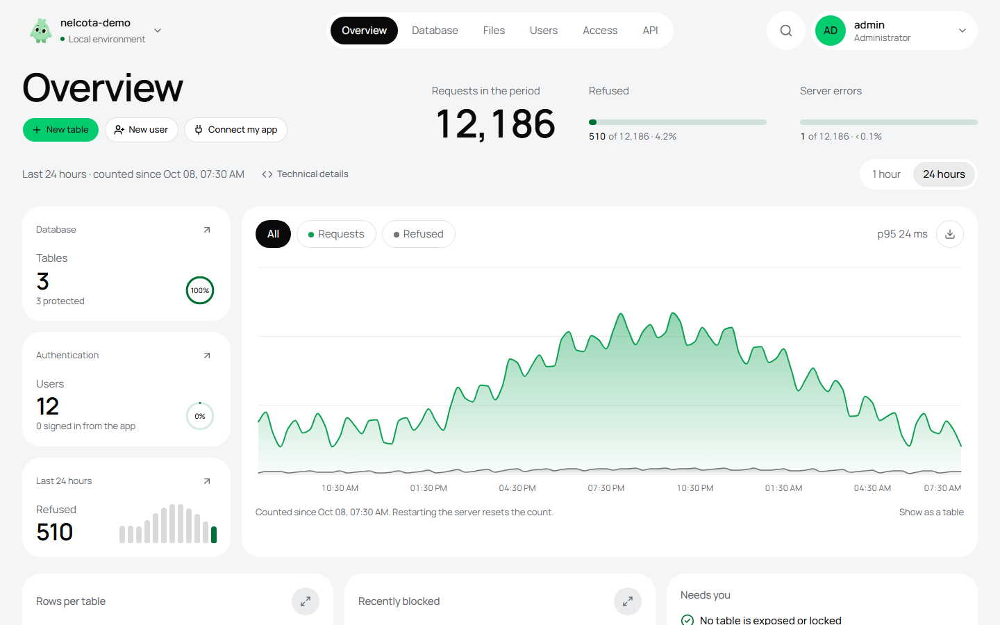

<div align="center">


# Nelcota

Open source backend-as-a-service for applications that use PostgreSQL.<br>
One Rust binary provides REST, authentication, file storage, webhooks and an admin panel.

[](https://github.com/Nelcota/Nelcota/actions/workflows/ci.yml)
[Releases](https://github.com/Nelcota/Nelcota/releases) · [Apache-2.0](LICENSE)

[Quickstart](docs/quickstart.md) · [Deploy](docs/deploy.md) · [Documentation](docs/README.md) · [Changelog](CHANGELOG.md)

</div>

<picture>
  <source media="(prefers-color-scheme: dark)" srcset="docs/assets/panel-overview-dark.png">
  
</picture>

## Why Nelcota

Use Nelcota when you want to own your database and deploy your backend on a VPS.
Your schema, grants, row-level security policies and functions remain SQL you
can export. PostgreSQL enforces data access; you do not need a separate Node
service for the backend or panel. Production deployments also use Caddy for
HTTPS, and optional integrations need their own SMTP or S3 provider.

## Quickstart

You need Linux, Docker, `curl` and `jq`. The installer downloads a published
binary and verifies its checksum. Use a fresh application directory:

```sh
curl -fsSL https://raw.githubusercontent.com/Nelcota/Nelcota/main/scripts/install.sh | NELCOTA_SKIP_DOCKER=1 sh
mkdir notes-app && cd notes-app
nelcota dev
```

Keep that terminal running. In a second terminal, enter `notes-app` and run:

```sh
set -eu
mkdir -p migrations
cat > migrations/V1__notes.sql <<'SQL'
CREATE TABLE public.notes (
    id bigint GENERATED ALWAYS AS IDENTITY PRIMARY KEY,
    owner uuid NOT NULL DEFAULT auth.uid(),
    body text NOT NULL
);
ALTER TABLE public.notes ENABLE ROW LEVEL SECURITY;
GRANT SELECT, INSERT, UPDATE, DELETE ON public.notes TO authenticated;
CREATE POLICY notes_owner ON public.notes FOR ALL TO authenticated
    USING (owner = auth.uid()) WITH CHECK (owner = auth.uid());
SQL
nelcota migrate
SESSION=$(curl -fsS -X POST http://127.0.0.1:8000/auth/v1/signup \
  -H 'content-type: application/json' \
  -d '{"email":"ana@example.com","password":"a-development-password"}')
TOKEN=$(printf '%s' "$SESSION" | jq -er '.access_token')
NELCOTA_SCHEMA_READY=0
for attempt in 1 2 3 4 5 6 7 8 9 10; do
  NELCOTA_READ_STATUS=$(curl -sS -o /dev/null -w '%{http_code}' \
    http://127.0.0.1:8000/rest/v1/notes -H "authorization: Bearer $TOKEN")
  if [ "$NELCOTA_READ_STATUS" = 200 ]; then NELCOTA_SCHEMA_READY=1; break; fi
  [ "$NELCOTA_READ_STATUS" = 404 ] || { printf '%s\n' 'Readiness request failed' >&2; exit 1; }
  sleep 0.2
done
[ "$NELCOTA_SCHEMA_READY" = 1 ] || { printf '%s\n' 'Schema is not ready' >&2; exit 1; }
curl -fsS -X POST http://127.0.0.1:8000/rest/v1/notes \
  -H "authorization: Bearer $TOKEN" -H 'content-type: application/json' \
  -H 'prefer: return=representation' -d '{"body":"My first note"}'
curl -fsS 'http://127.0.0.1:8000/rest/v1/notes?order=id.desc' \
  -H "authorization: Bearer $TOKEN"
```

The last request returns your note under RLS. This account/password is a local
example. The [full quickstart](docs/quickstart.md) adds the shared SDK schema,
generated types and a runnable client. On macOS/Windows, build with Rust as
explained there. The panel is at `http://127.0.0.1:8000/admin/`; read its generated
credentials locally from `.nelcota/dev.env`.

> [!WARNING]
> A `service_role` token bypasses RLS. Keep it in trusted backend code; never
> include it in a browser, mobile app or public example configuration.

## What's inside

| Capability | Reference |
| --- | --- |
| Schema-derived REST, filters, relations, RPC and OpenAPI | [REST API](docs/api.md) |
| Password/email/OAuth sign-in, Ed25519 JWTs and refresh rotation | [Auth schema](docs/schema-auth.md), [JWT and roles](docs/jwt-and-roles.md) |
| Private/public files, disk/S3 storage and signed URLs | [Storage](docs/storage.md) |
| Transactional events and signed delivery with retries | [Webhooks](docs/webhooks.md) |
| Embedded English/Portuguese database and account administration | [Panel](docs/panel.md) |
| Docker/systemd deployment, isolated projects, backups and database PITR | [Deploy](docs/deploy.md), [Backup](docs/backup.md) |
| JavaScript/TypeScript and native Rust clients | [TypeScript SDK](sdk/typescript/README.md), [Rust SDK](sdk/rust/README.md) |

## Status and roadmap

The latest published server is **0.4.0**. SDKs have independent versions.
`main` contains unpublished fixes and reusable auth/core packaging; see the
[changelog](CHANGELOG.md) and [release handoff](docs/onboarding/release.md).
A source build can report the same binary version as a published release until
its version is bumped: identify it by tag/commit and artifact hash.

Controlled panel updates are implemented in `main`, but require a new official
release and exact-binary VPS acceptance before activation. They are unavailable
in published 0.4.0. See [the update guide](docs/panel-updates.md).

Realtime subscriptions, Edge Functions, MFA and image transformations are not
implemented. Multiple isolated projects per Docker host are supported; shared
database tenant management is not built in. Versions remain 0.x: review upgrade
notes and test backup/restore before production changes. Measurements and their
operating limits are in [bench](bench/README.md).

## Documentation

Use the [task-based index](docs/README.md), [configuration](docs/configuration.md),
[CLI reference](docs/cli.md) and [security model](docs/security/README.md).
For a complete private Notes/file installation, follow [Notes staging](docs/onboarding/notes.md).

## Development

Source builds use Rust **1.99.0**, pinned in `rust-toolchain.toml`. Node is
needed for UI/TypeScript SDK development, not to run the Rust backend or panel.
See [CONTRIBUTING.md](CONTRIBUTING.md) for setup, targeted suites, contracts and
separate generated-panel commits. Read [CODE_OF_CONDUCT.md](CODE_OF_CONDUCT.md)
for community conduct and [SECURITY.md](SECURITY.md) for private vulnerability reporting.

## License

[Apache-2.0](LICENSE)
