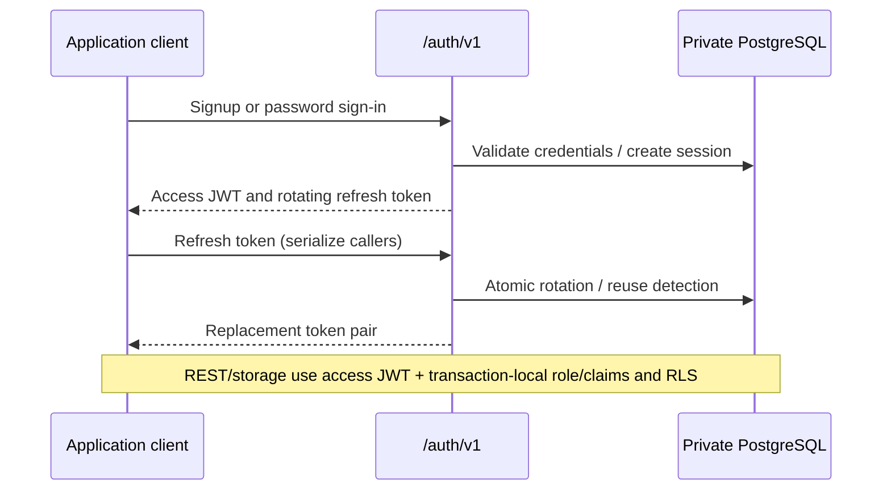

# Architecture

```
client ──HTTPS──▶ Caddy ──▶ nelcota (single binary) ──▶ Postgres 17
                              │ axum: /health, /rest/v1/*, /storage/v1/*
                              │ auth: validates JWT → Claims
                              │ core: pool (authenticator) + transaction with role/claims
```

## Prerequisites

This page describes current source ownership and budgets. To build it, use the
pinned Rust toolchain; PostgreSQL is required for runtime validation. Historical
architecture choices belong to the decision log, and published artifacts can
predate source-only capabilities.

## Crates

| Crate | Responsibility |
|---|---|
| `nelcota-core` | config (`figment`), HTTP errors, `Claims`/`Role`, pool, migrations, `begin_request` |
| `nelcota-auth` | `JwtVerifier` trait, EdDSA/HS256 keys and JWKS, `Auth` extractor, signup/login/refresh/logout, email links (recovery, confirmation, magic link), OAuth/OIDC providers, argon2id, rate limit |
| `nelcota-api`  | catalog introspection, SQL builder, CRUD/RPC, OpenAPI, TS types |
| `nelcota-storage` | files: buckets and objects under RLS (`storage` schema), bytes on disk or S3 (`object_store`), signed URLs, orphan collector |
| `nelcota-webhooks` | transactional row events, persistent delivery leases, signing, safe HTTP dispatch, retries and retention |
| `nelcota-admin` | panel at `/admin`: JSON API (`/admin/api`) + embedded Svelte SPA (`ui/dist`) |
| `nelcota-cli`  | host with N projects (`init`, `up`, `projects`, `remove`, `migrate`, `backup`, `upgrade`, `panel-login`...). Modules: `host` (registry), `naming`, `scaffold`, `caddy`, `registry`, `panel_login`, `lifecycle`, `backup`, `upgrade` |
| `nelcota-deployment` | release/protocol types, durable jobs, host leases and irreversible recovery decisions; CLI/admin adapt runtime effects and operator HTTP |
| `nelcota-server` | the `nelcota` binary: dispatches the CLI or starts the server (trace, timeout, CORS, gzip) |

The backend compiles into one binary, static with musl in the Docker image.
Artifact size depends on version/architecture and embedded assets; do not infer
current size or deployment capacity from older builds.

The query compiler separates the validated request representation (`query/mod.rs`),
URL parsing (`query/parse.rs`) and SQL generation (`query/sql.rs`), behind the
existing public interface. Panel handlers are grouped under `admin/src/tables/`,
`users/` and `policies/`, with small root facades that expose named handlers to
the router. Tables own row queries, structure, exports and DDL adaptation;
`tables/catalog` supplies metadata also used by overview and policies. Pure
DDL generation stays in `ddl/`, execution in `apply`, and SQL error adaptation
in `error`. The SQL feature also owns its autocomplete schema endpoint.

Authentication's HTTP handlers adapt requests to `accounts` and `sessions`.
`db` owns auth-role transactions and `request` owns HTTP metadata. `links`
owns single-use email links (token storage, email text, sending and sign-in
by link); `recovery` adds the password change, `confirmation` the signup
policy and `verify` routes a link by its `type`. `oauth` owns provider
sign-in: `provider` (with one module per provider) talks to the provider,
`flow` stores sign-ins in progress, `identities` decides which account opens
and `redirects` holds the allowlist. The panel's root assembles routes;
`auth`, `middleware`, `error`, `assets` and `state` own their respective behavior.

Storage's `upload` module owns streamed writes and their metadata commit,
`operations` owns reads/listing/deletion, and `signing` owns signed-file grants.
Their interface takes upload options and a byte stream and returns typed data.
The `http` adapter handles headers, response status, URLs and file serving for
both public routes and the panel. Policy checks still happen before bytes are
consumed, and failed writes still clean up their unpublished versions.

The CLI separates project lifecycle and version upgrades from backup workflows.
`backup/workflow` coordinates capture, retention and restore; `backup/remote`
owns S3 transport. Database and immutable file capture retain one owner so
their snapshot consistency remains intact.

Webhooks separate panel configuration/history (`management`), destination and
DNS policy (`destination`), HMAC (`signing`), lease persistence (`queue`), HTTP
delivery (`transport`) and async scheduling (`worker`). A PostgreSQL trigger
commits events with business rows; a dedicated two-connection pool and four
concurrent sends keep outbound work independent of API and panel traffic.
See [events and webhooks](webhooks.md) for delivery guarantees and limits.

Panel wire DTOs live in `admin/src/contracts.rs` and the existing structure/DDL
types. Their generated TypeScript and JSON Schemas are versioned with the UI;
standalone validators reject incompatible responses in the client. Row values
remain strings or NULL so decimal and bigint values retain precision.

The SQL editor streams messages over dedicated connections with a 30-second
statement timeout, four concurrent runs, 1000 retained rows per result, an 8 MiB
retained-value budget and 32 displayed results. It drains the entire batch after
reaching a display limit, preserving transaction semantics. Dropping the HTTP
future sends a Postgres cancellation request and closes its dedicated connection.
Ordinary API pool connections stay separate.

Table previews reuse one admin connection and roll back the caller's role
before reading owner metadata. Table exports use separate connections, with
two concurrent downloads, a 30-second statement timeout and a two-minute
response lifetime. Dropping a response cancels the query; a deadline closes
the connection even when its body is not polled. Admission remains occupied
through cancellation, and an interrupted stream fails instead of reporting
a complete file. Small-table counts probe at most 10,001 rows under a 250 ms
statement timeout; outgrown small-table estimates produce an unknown total.

Storage directory listing seeks through a generated parent-path byte key,
skipping each returned folder's subtree. Every seek runs against
`storage.objects` under the caller's RLS. NUL-separated UTF-8 segments preserve
C ordering and isolate literal prefixes, including Unicode, `%` and `_`.
An ordered scope-fingerprint/name index pages immediate files. Its generated
integer fingerprint supports seeks under RLS; exact bucket and parent checks
reject hash collisions. Listing transactions disable bitmap scans locally
to favor ordered page seeks when statistics are missing.
The key helpers only transform their inputs;
public execution preserves custom SQL writers without changing object RLS.
A bucket browser requests only that bucket's usage. Migrations V14 and V15
add user ordering and directory indexes. V15 computes the derived keys for
existing metadata and rebuilds the table under the migration lock, so
upgrades of large stores need time for that one-time rewrite.

DDL commits once and reports `applied` plus `catalog_pending`. An introspection
failure after COMMIT does not turn a successful mutation into an error. Catalog
reloads are serialized, and one worker retries failed refreshes with backoff;
the client refreshes its view without replaying the change.

`RemoteResource` owns loading, errors, cancellation and result ordering in table,
user and storage pages. Storage's upload queue owns progress, partial failures
and conflict retries, capturing the bucket and folder before navigation changes.
These modules have unit tests; browser flows and real-Postgres regressions run in CI.
`TableRows` owns row selection, loading and mutation reconciliation, including
captured primary keys and navigation during writes. The table page owns its
navigation, dialogs and presentation; its HTTP adapter supplies row operations.

Recovery operations own link issuance and atomic consumption, password updates,
session revocation and post-commit email delivery. HTTP handlers only extract
request metadata, apply public endpoint rate limits and adapt their results.
Migration operations return typed records and commit version allocation,
checksums and change tracking together; their `files` module owns names,
rendering and directory discovery, while the root handles HTTP downloads.

The REST root composes routes. Its `http` adapter handles URLs, preferences,
status codes and headers; `operations` compiles and executes CRUD/RPC under
the caller's role, returning PostgreSQL-generated JSON and range metadata.
Catalog internals separate `model`, `introspection`, `refresh` and `listener`
behind the public `CatalogHandle` interface. Keep the returned `ReloadListener`
owner alive until shutdown; dropping it cancels the listener/driver. Dropping
the final catalog owner cancels reconciliation, including pool waits.

The SQL executor owns connection lifetime, concurrency, result budgets and
cancellation behind `execute`; the route handles HTTP status and serialization.
The panel's `SqlExecution` owns request state and timing, and `StorageBrowser`
owns folder paging and refreshes after uploads/deletions. Both accept adapters
and discard stale responses when cancelled or navigated away from.

Native deployment separates machine/package provisioning, systemd units,
PostgreSQL configuration and atomic binary replacement. Caddy owns its own
configuration writes. PITR separates private configuration from process adapters
and restore sequencing; restore still coordinates stopping services, restoring,
waiting for promotion, taking a backup on the new timeline and starting the app.

## Source organization

Nelcota is a modular monolith: capability modules ship in one binary. Use a
small facade to expose a complete operation, keeping its validation, transaction
and cleanup together. HTTP adapters translate requests, results and errors.
Introduce interchangeable adapters where implementations actually vary, such
as disk/S3 storage and SMTP/test mail delivery. Concrete functions and existing
types are enough elsewhere; a generic repository or another layer is not needed
to wrap PostgreSQL.

Keep the existing crate boundaries: each crate owns a product capability,
and `server` assembles them. Add an internal module when behavior needs an
independent owner; file length alone does not require a new crate or layer.
Rust module facades use explicit exports. Types returned by a public method
must be reachable through its public interface, including errors such as
`SqlBusy` alongside `SqlExecutor`.

Bucket mutations belong to storage's operation interface on `StorageState`.
Both the public routes and panel call it; bucket privileges, RLS and foreign
keys remain PostgreSQL's responsibility. Operations return typed records and
bucket errors, while each HTTP adapter preserves its response/error vocabulary.
Only the panel adapter trims empty MIME inputs from forms. A failed deletion
rolls back before reading the optional file count for its error response.
Panel user operations accept the admin pool and return data; their HTTP adapter
owns messages and status codes. Password changes and session revocation remain
one transaction inside the operation.

The panel's `ui/src/lib/features/<feature>/` owns its page, state, HTTP
adapter, pure helpers, components and adjacent unit tests. `shell/` owns
navigation, the command palette and the application frame. Reusable panel
components live in `components/shared/`; shadcn primitives stay in
`components/ui/`. Table/policy metadata and DDL previews shared by several
features live in `shared/schema/`. Keep shared transport, contracts, resource
loading and browser persistence at the library root; persistence is named
`local-storage.ts` to distinguish it from the storage feature. API usage
examples belong to `features/api/api-examples.ts`.

Use relative imports within a feature and `$lib/...` for dependencies outside
it. Rust filenames use snake_case, TypeScript helpers use kebab-case, and
Svelte components use PascalCase. Use structs/enums or plain TypeScript types
for data; stateful modules compose existing resource modules behind their
own methods. Reuse generated wire types instead of copying their shape;
`SchemaResponse` serves both autocomplete and SQL request state. Do not edit
the generated contracts or validators by hand.

Rust unit tests stay with their implementation. Integration scenarios stay in
`server/tests`, where the production router and a real PostgreSQL instance
are assembled. `tests/admin.rs` loads feature modules under `tests/admin/`
as one integration suite. `tests/common/panel.rs` owns panel login, cookie
assertions and request helpers shared with storage and architecture suites.

## A request's flow

1. `Auth` (extractor) turns the `Authorization` header into `Claims`.
2. The operation takes a connection from the pool (always as `authenticator`).
3. `db::begin_request` opens the transaction and sets role + claims.
4. The query runs under RLS; Postgres builds the JSON (`json_agg`) and the API
   just passes the bytes through.
5. COMMIT. Postgres errors are translated by `ApiError::from_db`.

`db::begin_request` is the **only** path to run SQL on behalf of a user.

## Startup

1. Loads the config (`NELCOTA_*` + optional `nelcota.toml`).
2. `db::bootstrap` (admin connection): advisory lock → migrations in
   `migrations/` (control table `nelcota.schema_migrations`) → `authenticator`
   password (SCRAM verifier computed locally).
3. Creates the API pool and starts the HTTP server. Shuts down cleanly on
   SIGTERM/Ctrl+C.

## Routes

| Prefix | Served by | Authorization |
|---|---|---|
| `/health` | server | public |
| `/rest/v1/*` | api | JWT → role → GRANTs + RLS |
| `/auth/v1/*` | auth | public (signup/login/email links/provider sign-in) or the user's JWT |
| `/storage/v1/*` | storage | JWT → role → RLS on `storage.objects`; public buckets and signed URLs without a token |
| `/admin/*` | admin | panel login (session), admin connection |

## Internal migrations

Plain SQL in `migrations/V<n>__<name>.sql`, applied by `refinery` and recorded
in `nelcota.schema_migrations` (version, name, date, checksum). They can be
applied by hand with `psql` if Nelcota no longer exists. The early ones
(V1–V6) keep their original Portuguese names and comments: refinery checksums
name and content, so editing them would break existing installs (D68).

## Authentication flow



The project panel has separate administrator sessions. Controlled updates add
separate controller/worker processes using the same binary and a separately
enrolled operator origin; they do not grant host authority to a project login.
The controller remains source-only pending a new release and VPS acceptance.

## Related guides

See [decisions](decisions.md), [REST API](api.md), [auth](schema-auth.md),
[webhooks](webhooks.md) and [deploy](deploy.md). Reusable-auth setup is in the
repository-only guide at `docs/auth-integration.md`. Mermaid diagrams render
on GitHub; the current embedded reader displays their source.

## Host controller boundaries

Host project management keeps pure commands, bounded DTOs and durable receipts
in `nelcota-deployment`; root effects, policy and recovery live in `nelcota-cli`. `nelcota-admin` is an unprivileged HTTP adapter. The separately
authenticated UI requests plans and confirmed operations through the worker;
project credentials never grant host authority. Updates, CLI mutations and host
jobs share one lease and refuse unresolved work. See `docs/host-management.md`
for the Unreleased feature’s enrollment, recovery and validation limits.
