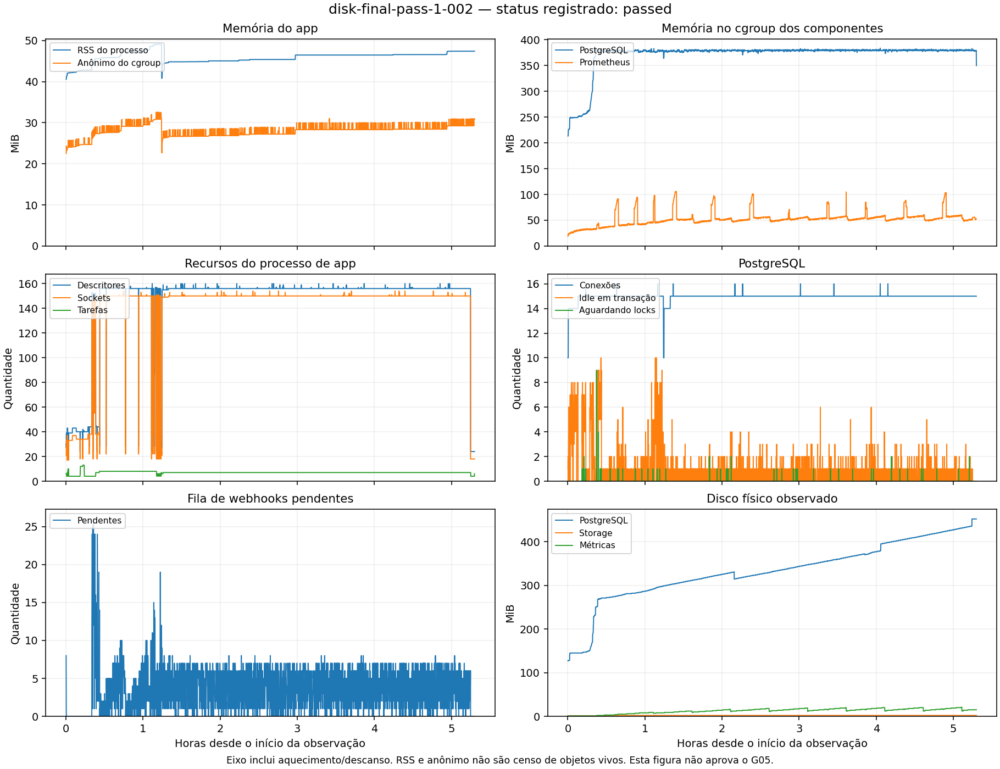

# G05 — relatório técnico de stress

**Estado: em execução, sem aprovação do G05.** Este relatório é atualizado
durante as campanhas. Checkpoint de carga consolidada: 17/10/2026, 13:07 UTC.
Atualização da investigação: 17/10/2026, 18:14 UTC.
Não houve merge nem deploy de produção. O trabalho está na branch
`test/g05-stress-verification`, no [PR #90](https://github.com/Nelcota/Nelcota/pull/90),
mantido como rascunho para revisão.

## Tempo efetivo e artefatos

O [checkpoint 019](results/stress/load-time-checkpoint-019.json) registra
**143.634 segundos, ou 39h53min54s, de carga efetiva concluída**. O cálculo
conservador exclui preparação, aquecimento, descanso, fases interrompidas,
controles artificiais e dupla contagem de janelas simultâneas. Tempo mínimo
de oito horas atingido não significa aprovação dos demais critérios.
O tempo parcial das campanhas ainda abertas não está somado nesse checkpoint.

| Artefato | Identidade e alcance |
|---|---|
| Código após as correções de cancelamento SQL/export e de exportação grande não consumida | Regressões reais aprovadas; [último antes/depois](results/stress/export-large-unpolled-deadline-after.json) inclui 17 testes. Binário final reconstruído; campanhas afetadas continuam pendentes |
| SHA-256 do binário de baseline preservado | `75c44c85a85db26195166aa1d2c6caf481e3db476801ec8131525ef62adf1be0` |
| Último candidato local congelado (007) | `35f4a9725d7edcf571f91084c555c127e7323653`; SHA-256 `96811748f1f45ad4894114188642f9343df661c750ad22768eaf2275659081b1`; 30.484.800 bytes; build release de 93,286 s. [Proveniência](results/stress/final-local-candidate.json). Inclui as dez correções e os guias reconstruídos. Checkout limpo antes/depois do build. Smoke HTTP real dos cinco cenários aprovado; primeira nova campanha de endurance iniciada. CI18/18 e suíte nativa12/12 passaram nas mesmas árvores de produto; campanhas finais e comparações ainda precisam encerrar |
| Candidato006 preservado | Fonte `860d2f9`; ELF `c7e3d254...`; [proveniência histórica](results/stress/final-local-candidate-860d2f9.json). CI18/18, native12/12 e dois ciclos browser com sobreposição real passaram nesse produto. A décima correção posterior exige novas verificações |
| Candidato anterior preservado | Fonte `f40774e`; ELF `9cc6cbf0...`; [proveniência histórica](results/stress/final-local-candidate-f40774e.json). CI ordinário 18/18 e suíte nativa 12/12 passaram nesse produto; esses resultados não certificam a correção posterior do SDK |
| Candidato nativo anterior do Actions | Mesma fonte histórica de produto `f40774e`; ELF `872c3b1efc71e0118386cdd3caf36bae0de26cb213307b91396fe30c0af83d75`, 30.463.736 bytes. [12 relatórios históricos](results/stress/native-final-suite-f40774e/index.json) aprovados no mesmo ELF; diferença entre hosts registrada, sem alegar build byte a byte reproduzível |
| Suíte nativa publicada do candidato006 | Fonte `860d2f9`; ELF `6aa5d48e502dc9b2ac46c595bc24bea4e56a5960f07af81c291e8f8b2708aedc`, 30.463.736 bytes. [12 casos originais](results/stress/native-final-suite-860d2f9/index.json) aprovados, com limpeza, dois restores e reconciliação de 30 ACKs após perda da RAM da VM em cada passagem. Não resolve a falha nativa original nem certifica o candidato007 |
| Novo candidato nativo007 do Actions | Fonte `35f4a9`; ELF comum `d0d1090c91da4435a0d27dcf1dddba1b8695f18f944b1dd8cc5e472089d17432`, 30.463.736 bytes. [Suíte39036557006](https://github.com/Nelcota/Nelcota/actions/runs/39036557006) aprovada nos12casos, com limpeza e sem guardas críticos. Os dois runtimes reconciliaram30ACKs cada; restore1,634/2,174s, retorno da convidada13,653/17,043s. Nenhum dos dois cortes coincidiu com write em voo observado. [Relatórios](results/stress/native-final-suite/index.json). ELF local e remoto são identificados separadamente, sem alegar reprodução byte a byte |
| SHA-256 do workload k6 atual | `0ac01578bf19155302fe465884b480d792569086f23bb4ba3615ca5f0ce2547d` |
| Baseline em disco no protocolo atual | Snapshot imutável de `1f391594dd8db6cccac54d6720d90c33d461d1f1`; `disk-final-pass-1-002` concluiu como baseline no binário retido, com protocolo atual |
| Primeira execução nativa separada | [Actions 38962480993](https://github.com/Nelcota/Nelcota/actions/runs/38962480993), código congelado `e80770b3f6aa1f64d011a3d62f8ebf0f1201bdac`; reprovada no oráculo de signup antes do backup |
| Primeiro fluxo nativo completo | [Evidência](results/stress/native-vm-runtime-pass-1.json), código `7e1bd25b20a706c66d0be549c6f85851b6db843f`; aprovado no escopo funcional declarado |
| Candidato nativo com correção PostgreSQL | [Evidência](results/stress/native-vm-runtime-candidate-pass-1.json), código `6f8a3e727b85b869318c2a2712982293c0724125`; binário `0cccc84840b5d09ee76b1ab2005b52e7d702bd44c9f9c7662df5c6bde82e110f`, verificado dentro da VM |
| Correção de cwd, ativação nativa | [Antes](results/stress/native-default-root-before.json)/[depois](results/stress/native-default-root-after.json), código posterior `b43dc5802d6d236a3ed5b8c0253122ee12b8ae5e`; valida init/up/HTTPS; a migração no cwd/`NELCOTA_ROOT` teve defeito próprio corrigido e repetição com SQL confirmada |
| Propriedade de um host nativo por máquina | [Antes](results/stress/native-host-root-before.json)/[depois](results/stress/native-host-root-after.json), código posterior `f560493ae6bcd8c4c94d51b6d7d049a608b30de0`; binário `27a7fb004db277ec59bd071f0cba8f009e31f416d710cda7880daa3bc5c844ae` |

Os binários anteriores e o baseline permanecem preservados. A correção mais
recente, no SDK, já tem novo build release e exige repetição das campanhas
afetadas. Campanhas interrompidas continuam registradas com seus resultados
originais e sem crédito do soak parcial. Após o baseline maior em disco, uma
tentativa candidata anterior foi parada antes da fixture. A sequência final007
está ativa; sua primeira endurance em disco ainda precisa encerrar.

Cada campanha preserva manifesto de propriedade, limites, configuração,
hashes das ferramentas/imagens, fases, timestamps monotônicos, métricas e
recibo de limpeza. Os arquivos privados ficam fora do Git: credenciais,
cookies, URLs assinadas, dumps, SQL privado e payloads não são publicados.
O backend de produção continua um único binário Rust, sem Node ou Python.

## Situação dos 12 critérios

| # | Critério do G05 | Situação neste checkpoint | Evidência ou impedimento |
|---|---|---|---|
| 1 | Inventário, baseline imutável e SLOs declarados | Atendido para o staging local | [Inventário](results/stress/coverage-inventory.json), [plano](results/stress/final-campaign-plan.json), manifestos por execução. A matriz registra os cenários ainda incompletos. |
| 2 | Calibração, unidades, amostragem e oráculos | Duas matrizes reais corrigidas aprovadas; fechamento ordinário pendente | [Duas passagens](results/stress/matrix-sdk007-two-corrected-passes-001.json): degraus de 300 s em 16/32/48/64 iterações/s, oráculos completos, 43 controles por passagem, sem chegadas perdidas. Não prova capacidade máxima nem fecha os demais perfis. |
| 3 | Cancelamento, watchdogs, redação e limpeza restrita | Demonstrado nos escopos local e nativo executados | [Controle nativo de guardas/pidfd](results/stress/native-guards-pidfd.json), interrupções reais e recibos de limpeza. A VM própria também confirmou limpeza e limites reais de kernel, sem guard crítico disparado nas execuções aprovadas. |
| 4 | Duas passagens de steady/staircase/picos/descanso | Em execução no candidato007 | Primeira campanha nova em disco iniciada às13:34:48UTC. A sequência prevê duas passagens completas por backend e para em qualquer falha; início de campanha não é aprovação. |
| 5 | Toda a matriz funcional, de segurança e concorrência | Parcial | Duas matrizes completas do backend passaram no ELF anterior, com variação de calibração ainda investigada. Um ciclo browser/auth passou no oráculo anterior; a repetição revelou a nona falha. Novo oráculo prova sobreposição real e exige novas passagens. CI funcional e subconjuntos não substituem os demais cenários. |
| 6 | Isolamento/fairness em 1/5/10 projetos e controle responsivo | Reprovado/incompleto | Cinco/dez projetos tiveram falhas anteriores de fairness/drain. Novo smoke compartilhado falhou com 101 registros, incluindo 8 SLOs absolutos. Smoke de cotas de 10ms falhou com 106 registros relativos, sem falhas absolutas; 1.381 eventos íntegros e limpeza completa. Nenhum smoke substitui os passos obrigatórios de cinco minutos. |
| 7 | Quatro horas contínuas em disco e S3 no artefato final | Pendente | Três execuções históricas completaram fisicamente quatro horas, com aprovação de contadores retirada. Uma nova campanha em disco passou no protocolo atual, como baseline; correções posteriores invalidaram as campanhas afetadas do candidato. Nenhuma campanha do próximo candidato, com as dez correções, foi aprovada até aqui. |
| 8 | Falhas, drain, restart, restore e deployment aplicável | Parcial | Duas matrizes finais restauraram alvo local novo com bytes/usuário e rejeição JWT verificados; RTO 2,597/2,500 s. A suíte nativa final passou duas vezes, com cortes após ACKs. Os novos cortes com write observado em voo, faults completos, atualização operacional, DNS/ACME públicos e recuperação fora do host permanecem incompletos. |
| 9 | Recursos, invariantes de dados/arquivos/eventos e regressão | Parcial | Invariantes locais e plateaus observados; precisam das campanhas finais comparáveis. Retenção anônima do provedor ainda exige atribuição. |
| 10 | Correções focadas e regressões dos defeitos confirmados | Dez defeitos reproduzidos; regressões focadas aprovadas, campanhas finais pendentes | Cinco falhas na CLI, três de SQL/export e duas no SDK. A nova falha bloqueava clientes independentes no servidor: 202 aprovados/2 reprovados antes, 204/204 aprovados depois. A falha nativa original e a fairness ainda exigem investigação. |
| 11 | Rust/UI/SDK/lint/CI correspondentes ao SHA testado | Produto007 e executor 3cc1b83 aprovados; preflight e campanhas finais pendentes | [CI 3cc18/18](results/stress/ci-host-private-files-product-trees.json), SDK204/204 e [native12/12](results/stress/native-final-suite/index.json). O merge realmente checado tem árvore completa de 3cc e seis árvores de produto do build. A extensão tem 55 controles focados e descoberta Python completa aprovada, sem contagem inferida; seu preflight real ainda precisa executar. |
| 12 | Relatório, limites e todos os testes falhos/bloqueados/não executados | Em consolidação | Este relatório e o [registro detalhado](stress-verification-execution.md) preservam os resultados; ainda há campanhas abertas. |

## Falha original do navegador: SLO de refresh ainda sem causa confirmada

A [primeira repetição final007](results/stress/browser-sdk007-refresh-slo-first-failure-001.json)
falhou em `g05_auth_refresh_slo`, após27guardas aprovadas. O teste antigo
lançou a exceção antes de exportar os percentis calculados; o valor exato
não foi preservado e não é inventado. O controle de sobreposição passou:
48chamadas SDK, uma requisição real de refresh e uma trava ocupada/duas na
fila. As7amostras não registraram OOM, reinício ou violação de recursos, e a
limpeza foi confirmada. Isso não prova a causa da latência nem aprova o ciclo.

O controlador remoto parou na falha. A campanha local de disco continua
em seu binário e executor congelados. A publicação de métricas foi estendida
para persistir somente dados numéricos completos antes da validação, com
as mesmas taxas, budgets e SLOs. Quatro regressões novas passaram entre38
controles focados; o [registro](results/stress/browser-auth-failed-slo-publication-regressions-001.json)
explicita que a ponte real e o problema de latência ainda precisam repetir.
Não é uma décima primeira correção confirmada de produto.

A [repetição completa seguinte](results/stress/browser-sdk007-measured-auth-pass-1-001.json)
passou sem mudar produto, carga, quotas ou SLOs:560requisições concluídas,
400respostas positivas e160rejeições esperadas,40usuários e zero sessões
restantes dessas contas. As cinco medições antes dos asserts foram gravadas.
O p95 de refresh variou de106,6a183,1ms; pior p99 de187,7ms. Foram219amostras,
gap máximo5,389s e sete plateaus. O p95 visual foi308,4ms em706navegações,
sem crescimento final de DOM/listeners; heap cresceu menos de2,3MiB por aba,
abaixo do limite de8MiB. Expiração real900s observada por1082,2s, com401no
acesso expirado e400no refresh revogado. A causa da primeira falha continua
aberta; não há comparação numérica antes/depois contra valores perdidos.
A [segunda passagem independente](results/stress/browser-sdk007-two-measured-passes-001.json)
também passou com as mesmas quotas e SLOs. A causa da primeira falha permanece
aberta. Os
[18checks do head80d29c8](results/stress/ci-sdk007-auth-metrics-product-trees.json)
passaram e têm prova da árvore completa do merge realmente usado no CI.

## Correção do executor: escala da capacidade da matriz

O driver real usava64como taxa provisória e oferecia16/32/48/64iterações/s
por300s, mas o novo validador de publicação esperava8/16/24/32. O
[controle antes/depois](results/stress/matrix-capacity-declaration-before-after-001.json)
reproduziu essa rejeição incorreta usando o parser e a expressão originais.
Driver, comando e validador agora compartilham a mesma declaração. A carga
máxima de64/s e as durações permanecem iguais; degraus não qualificados não
são removidos do relatório. As36guardas focadas passaram, incluindo três
regressões novas. A primeira tentativa do wrapper de descoberta falhou antes
dos testes e continua registrada. A matriz remota em andamento usa a revisão
antiga e mantém seu resultado. Na atualização seguinte, as [duas passagens
reais corrigidas](results/stress/matrix-sdk007-two-corrected-passes-001.json)
passaram; o relatório original reprovado permanece preservado.
Essa falha de medição não é uma nova correção de produto nem prova a causa
da variação histórica32→16/s.

A campanha final007 de disco qualificou400iterações mistas/s no teto já
predeclarado e iniciou o intervalo contínuo a280/s,70por cento. O teto não
é uma afirmação de capacidade máxima. As quatro horas, a reconciliação,
a recuperação e a comparação ainda precisam fechar.

## Matriz original reprovada e CPU do gerador

A [matriz final007 original](results/stress/matrix-sdk007-capacity-publication-failure-001.json)
encerrou como `failed`, com limpeza e371amostras. Os cinco casos de120s
passaram, mas a publicação rejeitou os degraus reais16/32/48/64. Os recibos
públicos de integridade e restore não chegaram a ser exportados; não são
tratados como aprovados. O controlador parou antes dos demais jobs.

Só16/s qualificou. Nas taxas32/48/64, o processo do gerador consumiu cerca
de97por cento de uma CPU, seu cgroup chegou a100por cento e houve perdas
de chegadas. Esses degraus não definem a capacidade máxima do servidor.
O perfil local mostrou recarga de CAs em cada novo opener, mesmo em HTTP.
O caminho do ledger agora reutiliza um verificador TLS, com handlers novos
por requisição, certificado/hostname obrigatórios e proxies desabilitados.
O opener das campanhas ordinárias e a regra de redirects ficaram idênticos.

Os [controles de construção](results/stress/ledger-generator-tls-construction-before-after-001.json)
mediram36,899ms de CPU em cinco construções originais,10,397ms com uma carga
de CAs na primeira sequência e2,493ms sem novas cargas após aquecimento.
Passaram43guardas focadas, incluindo quatro novas de concorrência e segurança.
Isso não é ganho de performance do produto. Duas novas matrizes reais,
com a mesma CPU, limites,64/s máximo e degraus de300s, ainda precisam fechar.
A variação histórica32→16/s e a falha anterior de SLO do navegador continuam
sem causa encerrada por esses controles locais.

## Primeira matriz corrigida e controle nativo adicional — 17/10, 16:20 UTC

A [primeira matriz corrigida](results/stress/matrix-sdk007-corrected-generator-pass-1-001.json)
passou no mesmo ELF remoto do candidato007, com 43 guardas, 371 amostras,
gap máximo de 5,237 s e limpeza confirmada. Os quatro degraus de cinco minutos
qualificaram 16, 32, 48 e 64 **iterações/s**. Todos os cinco cenários de 120 s
passaram a 51 iterações/s, equivalentes a 79,6875% da taxa qualificada.
Foram reconciliados 71.874 ACKs sem perda ou corrupção; 3.993 respostas reais
posteriores ao COMMIT foram descartadas e reconciliadas sem retry de mutação.
O restore para alvo local novo mediu RTO de 2,597 s e RPO superior de 18,001 s,
com bytes correspondentes e JWT de outro projeto rejeitado.

Na etapa de 64 iterações/s, o processo do gerador usou 9,400% de uma CPU e
seu cgroup, incluindo o observador, 12,232%. A execução anterior usava cerca
de 97% e 100%, respectivamente. As imagens, o binário, a quota e a escala
oferecida foram iguais; as VMs são distintas. A
[comparação com os limites da conclusão](results/stress/matrix-ledger-generator-before-after-001.json)
não anuncia ganho de quatro vezes no servidor. As 64 iterações/s produziram
57,6 escritas confirmadas/s; descartes deliberados de resposta não contam
como ACKs. Não se determinou a capacidade máxima, e a segunda passagem ainda
está pendente. A reprovação original continua preservada.

O [CI de 9b2af6d](results/stress/ci-sdk007-ledger-tls-product-trees.json)
passou nos 18 checks ordinários, incluindo a descoberta completa de Python.
O SDK realmente testado em `79bad325` tem árvore completa igual ao head
e as seis árvores de produto do build007; 204 testes unitários passaram.
Esses resultados não incluem a extensão nativa posterior nem aprovam o G05.

O commit `f1268a6` acrescentou o cenário separado `runtime-inflight`.
Um helper restrito segura um lock por até 30 s, com backstop de 40 s,
5% de CPU, 48 MiB e 16 tarefas, dentro do mesmo slice agregado. Uma escrita
HTTPS deve continuar pendente e aparecer esperando o lock. A idade da prova
inclui SSH, SQL e transporte e é checada novamente antes de solicitar SIGKILL.
Após recuperar a VM, os 30 ACKs e 31 valores devem existir; a escrita bloqueada
deve ter sido revertida, sem helper ou lock restante. Isso não é corte durante
COMMIT nem perda física de energia do host. Os
[35 controles focados](results/stress/native-inflight-cut-guards-001.json)
passaram, com dez novas fronteiras e zero skips; as duas VMs reais ainda não
foram executadas. O protocolo ordinário e o produto continuam iguais.
Uma revisão posterior acrescentou os probes explícitos após recuperar a VM:
REST anônimo deve retornar 401, o segundo usuário deve ver zero linhas e o
arquivo privado deve retornar 404 sem credenciais. Os
[35 controles repetidos](results/stress/native-inflight-cut-guards-002.json)
passaram; esses três probes reais continuam pendentes até executar as VMs.

A [validação prévia do próximo plano](results/stress/post-endurance-plan-prestart-uniqueness-001.json)
também detectou nove IDs duplicados antes de qualquer campanha desse plano.
A versão normalizada preserva todos os 15 casos, os mesmos argumentos e o
limite de disco PostgreSQL de 1.536 MiB. Essa correção de preparação não
representa teste de stress executado nem alteração de critério.

## Décima correção: isolamento do SDK no servidor

O [controle anterior](results/stress/sdk-independent-server-clients-before-001.json)
manteve um login pendente no cliente A e tentou ler a sessão já armazenada no
cliente B, criado com outro adaptador padrão em memória. A chave de lock global
por URL fazia B aguardar a rede de A. Os dois novos cenários falharam, tanto
com Web Locks quanto com a fila local, enquanto os 202 testes anteriores passaram.

O commit `9bca03b` usa uma fila identificada por um `Symbol` privado para cada
cliente de servidor com memória padrão. Adapters fornecidos e sessões no
navegador mantêm o nome de coordenação compartilhado. A
[verificação posterior](results/stress/sdk-independent-server-clients-after-ci-001.json)
passou 204/204 testes, sem pendentes, e os jobs Node22/24/26 passaram. O job
principal incluiu tipos, build, limites de tamanho inalterados, pacote, memória,
Node/Bun/Deno, contratos dos três browsers e o exemplo Notes.

Os relatórios separam o SHA do head do workflow do merge sintético realmente
checado no PR. Os dois arquivos de implementação foram obtidos nesses checkouts
e comparados byte a byte aos respectivos heads. Tokens e payloads dos testes
não foram publicados. Controles do SDK não recebem crédito de carga efetiva.

Os assets dos guias foram reconstruídos no commit `df77883`, após encerrar
a carga S3. Passaram 37 testes focados, typecheck e build. O CI anterior falhou
especificamente no check de `dist` versionado; essa falha foi preservada.
O produto com os assets corrigidos já tem freeze007; CI e repetições continuam.
Nenhum endurance do candidato006 foi iniciado antes dessa nova descoberta.

A [primeira passagem completa do browser no candidato006](results/stress/browser-sdk006-genuine-overlap-pass-1-007.json)
confirmou a correção anterior: 48 chamadas realmente sobrepostas geraram uma
requisição de refresh, com sete plateaus de recursos e limpeza confirmada.
A [segunda passagem](results/stress/browser-sdk006-genuine-overlap-pass-2-008.json)
também encerrou aprovada, com a mesma prova de uma rotação e sete plateaus.
São evidências históricas desse código, sem certificação automática da revisão
posterior do SDK ou do G05 completo.

## Staging e limites

Em 17/10, uma repetição real do browser revelou refreshes redundantes. A
[evidência antes/depois](results/stress/sdk-native-overlapping-refresh-before-after-001.json)
mostra a causa: a leitura inicial aguardava o mesmo Web Lock da rotação e
acabava usando a sessão substituta como snapshot original. O SDK agora captura
o estado visível antes dessa espera; o journal continua autoritativo dentro do
lock. Duas regressões cobrem caches aquecidos/frios e verificam que renovações
explícitas posteriores continuam rotacionando. O controle com backend HTTPS,
três abas e 48 chamadas realmente sobrepostas reproduziu duas requisições no
SDK anterior. A execução completa corrigida no navegador ainda está pendente.

A primeira suíte completa após a correção teve 201 testes aprovados e um
reprovado: o injetor de falhas contava aberturas do IndexedDB e atingiu a
publicação em vez da reserva. Ele passou a injetar a falha na reserva real,
mantendo a exigência de zero requisições HTTP. A repetição passou 202/202.
Uma tentativa de empacotamento falhou por cache npm ausente; a configuração
documentada de cache gravável permitiu repetir e aprovar pacote, runtime e
memória. As falhas originais permanecem preservadas.

As duas matrizes remotas anteriores reconciliaram, respectivamente, 44.092 e
34.902 escritas confirmadas sem perda/corrupção. Os restores mediram RTO de
1,850 s e 1,536 s, com RPO superior conservador de aproximadamente 18 s.
A calibração qualificou 32 e 16 iterações/s. Essa variação de 50% não tem causa
comprovada: o relatório anterior não exportava os passos reprovados. O novo
executor preserva todos os quatro passos de cinco minutos e CPU do gerador,
cgroup e steal do host. Os gates de latência e entrega permanecem iguais.

O [baseline maior em disco](results/stress/large-disk-retained-baseline-001.json)
passou com um milhão de linhas em cada tabela products/private, objetos de
1 MiB, 7.811 eventos únicos reconciliados e nenhum evento perdido, extra ou
duplicado. Foram 4.170 s efetivos, excluindo 15 s de aquecimento. O [baseline maior em S3 real](results/stress/large-s3-retained-baseline-001.json)
também passou: 7.612 eventos sem perdas/duplicações/extras, 786 amostras, gap
máximo de 11,6 s e census com 1M/1M linhas, 10.129 objetos e zero transações
ociosas. Acrescentou 4.170 s efetivos ao checkpoint019. Esses soaks de dez
minutos não cumprem o gate de quatro horas.

O ambiente local oferece cinco slots de afinidade e quota efetiva de quatro
CPUs para o controlador. Containers filhos têm limites próprios; não se
atribui a eles um limite agregado do cgroup do controlador que não os contém.
App, PostgreSQL e gerador usam CPUs distintas; a telemetria usa outro slot,
e o S3 real usa o slot adicional. As campanhas são serializadas localmente.

O perfil ordinário usa app de 1 CPU/128 MiB, PostgreSQL de 1 CPU/384 MiB,
gerador de 1 CPU/512 MiB com limite Go de 448 MiB e Prometheus de
0,25 CPU/512 MiB. O S3 ordinário acrescenta 0,5 CPU/1.024 MiB.
Os manifestos de cada topologia detalham quotas, afinidades e oversubscription
quando declarada. Reserva mínima: 10% de RAM disponível e 15% de bytes/inodes
livres. Banco, storage e telemetria têm guardas físicos próprios; nenhuma
injeção enche o disco compartilhado. O PostgreSQL de testes alheio às
campanhas foi preservado.

O perfil de endurance usa disco de banco de 1.024 MiB, WAL de 256 MiB,
storage ordinário de 1.024 MiB e duração máxima de seis horas, incluindo
preparação/fases anteriores. O soak planejado é de 14.400 segundos contínuos,
a 70% da maior taxa qualificada no teto previamente declarado. O teto
de 400 iterações/s não é anunciado como capacidade máxima física.

A fixture maior usa um milhão de linhas em **cada** tabela products/private
e objetos de 1 MiB. Seu perfil próprio usa PostgreSQL de 2.048 MiB de disco,
storage em disco de 1.024 MiB e storage S3 de 4.096 MiB. A mudança do orçamento
S3 foi declarada antes da nova medição, após a falha física original, e está
condicionada às reservas. Seu soak de dez minutos não substitui endurance.

## Defeitos confirmados e resultados antes/depois

As correções desta campanha atingem a confiabilidade do executor e
falhas reais de isolamento e inicialização operacional na CLI nativa. Não foi demonstrada melhoria
de desempenho do backend de produção por essa correção de segurança.

| Problema confirmado | Antes | Correção e verificação |
|---|---|---|
| Respostas semanticamente inválidas podiam contar como trabalho útil | Controles com leitura vazia/filtro incorreto/JSON inválido e outras respostas indevidas eram aceitos pelo workload anterior | Oráculos de conteúdo, identidade, ordem, expiração e bytes; [controle antes/depois](results/stress/semantic-oracle-before-after.json) preserva cada resultado esperado, inclusive as rejeições. |
| Comparação podia aprovar amostras iniciais de uma campanha posteriormente falha | Autocomparação real retornava sucesso | Comparador exige conclusão e limpeza válidas; [controle](results/stress/comparator-failed-run-before-after.json) passa de exit 0/aprovado para exit 1/rejeitado. Isso não é ganho de performance do produto. |
| Leitores SQLite permaneciam abertos até GC | 35 aberturas elevaram descritores de 4 para 39 | Fechamento explícito e regressões; mesmas 35 leituras mantiveram 4 descritores com GC desativado e bytes do banco intactos. [Evidência](results/stress/sqlite-archive-owner-before-after.json). |
| Consulta final de drops esparsos podia inventar zero | Segundo disco registrou zero; observador suplementar reteve 1.127 drops | Observação contínua por cenário, limites de cardinalidade, rejeição de resets/lacunas e prova fechada exigida nos comparadores. Controle nativo reteve 538 após expiração das consultas instantânea/range. [Errata](results/stress/sparse-drop-staleness-finding.json), [controle](results/stress/native-arrival-control-before-after.json). |
| HTTP físico e rejeições negativas também expiravam | Cada endurance histórico reportou zero negativos; auditoria de assertions recuperou 3.937 | Contadores por série/status com cobertura fechada e reconciliação independente; controle reteve 273 requisições, incluindo três 401, após expiração das séries. [Auditoria](results/stress/historical-http-counter-audit.json), [controle](results/stress/native-http-control-before-after.json). |
| Timeout de `docker stats` interrompia uma observação recuperável | Fleet de cinco projetos parou após timeout de 10 s | Fallback somente para timeout lê cgroup real do container, com CID, PID e geração/propriedade verificados; controle nativo confirma memória/tarefas/CPU/OOM. Não amplia o limite de lacuna de 30 s. Repetição da topologia permanece obrigatória. |
| Latência incluía apenas o último hop | Download com atraso inicial de 250 ms reportava p95 de 6,165 ms | Relógio monotônico mede a requisição lógica inteira; mesmo controle passa a 256,798 ms, com oito downloads verificados por lado. [Evidência](results/stress/native-logical-latency-before-after.json). Os valores maiores corrigem submedição, não representam regressão de servidor. |
| Segmento de bloco TSDB fazia reserva física não limitada por WAL/retenção | Primeira repetição final parou em 522 MiB contra guarda de 512 MiB | Segmentos explícitos de 16 MiB e caminho próprio comum aos executores; guarda continua em 512 MiB. Controle 004 confirmou flags, 2.000 incrementos e quatro snapshots reais de 1.004 séries cada, com limpeza. [Antes/depois](results/stress/native-metrics-compaction-before-after.json). |
| Novo oráculo nativo esperava o status incorreto no signup | VM real retornou o `201` documentado, mas o executor exigia o `200` genérico e parou | Exigência exata de `201`, token presente e identidade correta, com regressão de respostas HTTP. Repetição em VM nova aprovada; não se alterou a API. [Antes](results/stress/native-vm-runtime-first-failure.json), [depois](results/stress/native-vm-runtime-pass-1.json). |
| Resultado nativo foi truncado na anotação do Actions | Mensagem cortada em 4.096 caracteres; uma primeira fragmentação também excedeu dez anotações por step | Transporte gzip/base64, no máximo nove fragmentos mais resumo, SHA-256 e regressões de reconstrução. Os relatórios originais foram recuperados integralmente pelo workflow, preservando os veredictos. Download local de artifacts continua indisponível. |
| Administração nativa podia alterar outro cluster PostgreSQL | Com `17/main:5433` e `17/sentinel:5432`, `init` retornou sucesso e mudou a senha do cluster sentinela | Preflight rejeita layout incompatível antes de pacotes/host/config; clientes administrativos são vinculados a `17/main` e ao socket/porta esperados; senha segue por stdin. Seis regressões Rust e a [VM antes](results/stress/native-postgres-collision-before.json)/[depois](results/stress/native-postgres-collision-after.json) comprovam a fronteira. Fluxo nativo normal corrigido também passou. |
| Instalação no diretório atual gerava unit inválida em runtime | `init` exit 0, `EnvironmentFile` relativo, `up` timeout e 14 reinícios, apesar de `systemd-analyze verify` exit 0 | Diretório resolvido antes de gerar configuração. VM nova confirmou caminho absoluto, init/up/verify exit 0 e HTTPS válido; 98,166 s com preparo, 19 amostras e limpeza. A extensão de migrações revelou um quarto defeito, descrito abaixo; o caminho de ativação permanece validado no escopo original. |
| Outro diretório podia tomar a instalação nativa | Segundo init com `--skip-checks` exit 0 mudou senha/Caddy e criou outro manifesto/unit | Lease da máquina e owner persistente antes de provisionar; fronteira de diretório e liberação somente após remoção completa. Na VM nova: rejeição específica exit 1, senha/Caddy/linha inalterados, nenhum segundo manifesto/unit; 72,177 s com preparo, 14 amostras e limpeza. Rust de `f560493`/`3b56b25` passou; remoção real confirmou owner liberado e recusa de `up` no host vazio. |

| Remoção nativa declarava sucesso apesar da configuração de backup não removida | `remove --no-backup` exit 0, unit/cluster apagados e owner liberado apesar do erro de unlink | Validação do caminho antes de destruir o runtime, propagação de erros e mesma regra na desativação do PITR. [Antes](results/stress/native-remove-boundary-before.json)/[depois](results/stress/native-remove-boundary-after.json): exit 1 específico, owner/manifest/cluster/linha preservados, seguido de remoção normal com backup bem-sucedida. As exclusões do sentinel eram solicitadas pelo probe; não foram classificadas como perda não intencional de ACKs. PITR real remoto continua não certificado. |
| Migração nativa no cwd/`NELCOTA_ROOT` tentava adquirir o próprio lease | Dois comandos reais retornavam exit 1/`deployment_busy`, com o lease externo corretamente mantido | Filho nativo recebe `--dir` explícito do projeto, preservando o lease do host no pai. [Antes](results/stress/native-cwd-migration-before.json)/[depois](results/stress/native-cwd-migration-after.json): ambos exit 0, tabela e journal presentes, uma linha em SQL. [Errata](results/stress/native-cwd-migration-census-erratum.json) retira a alegação antiga de ausência de tabela, pois o primeiro census comparava bytes/string; não retira os exits 1/busy observados. |
| Census nativo podia negar presença SQL válida | Repetição já tinha migrate exit 0, mas o oráculo interpretava `b"t"` como falso e não contava linhas | Parser de bytes estrito, presença de tabela/journal separada e COUNT decimal limitado. Três regressões; VM nova passou com COUNT 1. A [execução intermediária](results/stress/native-cwd-migration-census-failure.json) continua reprovada. |
| Descoberta de alocador ignorava o prefixo real e não publicava arquivo legível | 17 exports reais continham `rustfs_memory_allocator_`, mas o controle contou zero; uploader falhou no JSON 0600 | Prefixo corrigido, disponibilidade explícita separada de valor e publicação validada 0644. [Primeira falha](results/stress/provider-memory-discovery-first-failure.json) preservada; [repetição corrigida](results/stress/provider-memory-discovery-after.json) passou com 17 exports e três gauges de memória, inclusive publicação. Bytes solicitados vivos continuam indisponíveis e owners não verificados. |

Outras mudanças de propriedade, filesystem, fault injection, inicialização
de clientes, browser, ingress e teardown estão descritas por commit no
[registro de execução](stress-verification-execution.md). Falhas de embalagem
ou de oráculo dos controles continuam registradas como falhas originais;
uma análise posterior não reescreve seus veredictos.

## Resultados de carga, integridade e recursos

| Campanha | Resultado observado | Limite da conclusão |
|---|---|---|
| Disco histórico 1 | 14.400 s contínuos, 4.031.806 operações úteis e 248.381 eventos reconciliados | Aprovação final retirada por contadores esparsos; não certifica protocolo atual. |
| S3 histórico 1 | 14.400 s contínuos, 4.031.965 operações úteis, 249.824 eventos reconciliados, 16 renovações de sessão e dois ciclos de poda | RustFS real local; aprovação dos contadores retirada. Não representa AWS, rede remota ou durabilidade fora do host. |
| Disco histórico 2 | 14.400 s contínuos, 4.030.874 operações úteis e 249.795 eventos reconciliados | 1.127 drops retidos por observador suplementar; protocolo original insuficiente, mantido como diagnóstico. |
| Disco final 001 | 4.290 s efetivos concluídos, 833 amostras, calibração de 400/s repetida | Interrompido automaticamente pela reserva TSDB de 522 MiB. Soak parcial excluído do tempo efetivo; invariantes finais não alcançadas; limpeza confirmada. |
| Disco no protocolo atual, baseline | 14.400 s contínuos, 4.032.001 operações úteis, 4.035.938 requisições do tráfego principal, 3.937 negativas esperadas, zero drops/erros inesperados; 257.500 eventos reconciliados | Binário retido `75c44c85`, fonte `2efede8`; 3.283 amostras, gap máximo observado de 11,0 s, 16 renovações, dois ciclos de poda e limpeza. Não certifica o novo artefato. |
| Um projeto/Caddy | 2.490 s de carga, 506 amostras, 32/s qualificados e nominal de 25/s, 2.928 eventos reconciliados | Primeira execução no protocolo anterior de latência/telemetria; requer duas passagens finais comparáveis. |
| Cinco projetos compartilhados, smoke | Todos os cinco cenários concentrados falharam em fairness; RLS saudável p95 chegou a 217,638 ms contra meta de 200 ms | 1.129 eventos reconciliados e drain/limpeza aprovados não promovem o resultado de desempenho. |
| Cinco projetos compartilhados, completo | 2.790 s concluídos, 604 amostras, 24 falhas prévias de latência em noisy-mixed | Interrompido em noisy-login por timeout do observador; invariantes finais não alcançadas, limpeza confirmada. |
| Dez projetos, duas fixtures independentes | 3.990 s efetivos por execução; três medidas balanceadas e reload Caddy passaram a 4/s por projeto | Fairness reprovada em todos os cinco cenários concentrados; drain de 30 s terminou com 5.834/7.010 pendências no projeto quente. Invariantes finais não alcançadas. |
| Browser/SDK 1 | Três abas, 511 navegações reais; p95 visual de 399,4 ms; 300 clientes descartados coletados; upload/cancelamento/renovação reais | Primeira passagem Chromium local, sem sandbox interno do Chromium; segunda passagem pendente. Isolamento externo do container permanece ativo. |
| Fault/recovery 1 | 53.049 ACKs reconciliados, 2.938 respostas reais pós-COMMIT descartadas; zero ACK perdido/corrupção observada | Primeira passagem; respostas ambíguas foram consultadas, sem retry automático de mutações. |
| Runtime nativo corrigido | Inicialização, migrations repetíveis, HTTPS validado, RLS, backup/restore e boot após interrupção da VM; 30 ACKs externos reconciliados sem perdas/duplicações/extras | 168,203 s incluindo preparo, 32 amostras, limpeza confirmada. Restore no mesmo alvo de 2,108 s e recuperação da convidada de 16,367 s; sem escrita em andamento no corte e sem alegação de durabilidade fora do host. |
| Relógio em VM descartável | Passo observado de 1.018,326 s, JWT expirado 401, serviço preservado/anônimo negado; relógio/NTP restaurados, offset final 0,471 s e acesso ordinário recuperado | [Evidência](results/stress/native-clock-drift-pass-1.json), sem alterar o relógio do host/controlador e sem crédito de endurance. |
| Contratos de instalação nativa | Caminho de ativação no cwd e recusa de outro diretório passaram em VMs próprias | Não substituem a repetição completa de runtime após todas as correções; cwd/`NELCOTA_ROOT` migrate agora passou com tabela, journal e contagem SQL confirmados. |

A [campanha atual em disco](results/stress/disk-current-protocol-baseline.json)
fechou **62 fases** com contadores contínuos HTTP/arrivals, 400 iterações/s
qualificadas em passos de cinco minutos no teto pré-declarado e soak a
280/s (70%). O teto de 400/s continua sendo limite da investigação, sem
alegação de capacidade máxima física. App e PostgreSQL preservaram seus
processos durante os 14.400 s. O census read-only confirmou 100.000 linhas
products, 100.000 private, 10.129 objetos e zero transações ociosas abertas.
Invariantes finais: zero pendências, assinaturas inválidas, eventos perdidos,
duplicados ou extras; 129 objetos verificados e 10.129 objetos físicos com
2.195 bytes. SQLite fechado passou integrity_check sem sidecars.

Os cinco descansos após picos e o descanso final de 180 s tiveram os mesmos
**24 descritores, quatro tarefas do SO e 18 sockets**, sem transações presas/locks.
RSS máximo geral: 49,1 MiB; no soak: 47,4 MiB. Disco PostgreSQL: máximo
452 MiB. Não houve OOM. A mediana dos primeiros/últimos 15 minutos do soak
subiu de **44,824 para 47,395 MiB de RSS** e de **26,668 para 29,242 MiB
anônimos**. Essa elevação ainda exige atribuição; censos estáveis de recursos
não provam ausência absoluta de vazamento de heap. A repetição no candidato
e, se persistir, um diagnóstico de alocação de quatro horas foram mantidos
no plano, separado das comparações ordinárias.

[CSV numérico](results/stress/disk-current-protocol-baseline-resources.csv.gz),
[índice/checksums](results/stress/disk-current-protocol-baseline-resources.csv.index.json),
[SVG](results/stress/disk-current-protocol-baseline-resources.svg) e
[recibo da figura](results/stress/disk-current-protocol-baseline-resources.json)
preservam o encadeamento entre observações, harness e binário. A figura
mostra tempo de observação, incluindo aquecimento/descanso, que não substitui
o tempo efetivo de carga do checkpoint.

No fault pass, o restore em alvo local novo levou **2,636 s**, com RPO
superior medido de **17,997 s**. O snapshot tinha 49.692 operações contra
50.338 na origem: as 646 posteriores representam rewind intencional do
restore, e não perda não intencional de ACKs na origem. O backup foi realizado
com writers SQL controlados e arquivos imutáveis; não certifica todo cenário
de escrita concorrente de objetos, PITR ou restauração física fora do host.

Os plateaus observados do app histórico chegaram a 24 descritores, quatro
tarefas e 18 sockets após o descanso. O diagnóstico separado de uma hora
com glibc distinguiu cerca de **1,97 MiB em uso** de **24,00 MiB livres**
retidos nas arenas. O controle nativo incluiu alocação/liberação por worker;
não houve `malloc_trim` forçado para disfarçar RSS. Instrumentação de
alocação fica fora das comparações ordinárias de performance.

O provedor real apresentou memória anônima de cerca de 415 MiB no trecho
final histórico, sem atribuição completa entre MiMalloc, caches e objetos
vivos. Não se declara ausência absoluta de vazamento. O diagnóstico físico
de trash mostrou cerca de 17 MiB após DELETE, zero objetos lógicos, e
reclamação automática até 1 MiB com namespace de trash vazio após mais de
330 s. As falhas originais dos oráculos 002/003 foram preservadas; o
[verificador posterior](results/stress/native-s3-trash-reclamation.json)
validou as observações congeladas sem forçar GC. Essa conclusão física não
explica toda a retenção de memória anônima. As duas passagens independentes
do diagnóstico de runtime também passaram: três perfis novos por passagem,
960 ciclos PUT/GET/DELETE com bytes verificados e157 amostras por perfil.
Os perfis alteraram somente workers normais ou de fsync, individualmente;
o perfil com quatro workers normais teve picos maiores de memória e tarefas.
Esses resultados não justificam mudar os defaults do provedor e continuam
sem atribuir bytes vivos. [Passagem1](results/stress/provider-runtime-corrected-pass-1.json)
e [passagem2](results/stress/provider-runtime-corrected-pass-2.json). A descoberta remota com o digest
exato recebeu 17 exports OTLP autenticados e observou gauges MiMalloc de
reserved/committed/page-committed. A flag
`malloc_requested_bytes_available = 0` impede interpretar requested-total como
bytes vivos. O próprio controle teve duas falhas; a repetição corrigida passou no escopo
de descoberta/publicação. O relatório original permanece bloqueado e o job original vermelho.

## Commits de referência, validação e pendências

| Commit | Mudança com evidência correspondente |
|---|---|
| `948f519` | Comparações dependem de trabalho útil e conclusão válida. |
| `5829717` | Oráculos semânticos antes da certificação de carga. |
| `c1e40bf` | Fechamento dos leitores SQLite. |
| `f899aca` / `d4ea5bc` | Retenção contínua de drops e controle real de expiração. |
| `c276cc3` | HTTP/rejeições esparsas e fallback de cgroup com propriedade. |
| `b82699f` | Latência da requisição lógica completa. |
| `c769934` | Preservação/análise da reclamação física S3. |
| `1f39159` | Reserva TSDB limitada, perfil estrito e exportação numérica. |
| `22acf21` / `e80770b` / `7e1bd25` | Inventário/execução nativa KVM, correção do oráculo de criação e publicação íntegra de evidências. |
| `0028307` / `d0927b5` | Isolamento dos clientes administrativos PostgreSQL, preflight de clusters e seis regressões; ordenação do módulo de testes e tradução do guia. |
| `6767e15` / `dec797d` / `6f8a3e7` / `77d2335` | Reprodução real da colisão, evidências recuperáveis e verificadas, retenção do binário e probes dos contratos de instalação. |
| `b43dc58` | Correção do caminho absoluto do host, com regressão real de ativação aprovada. |
| `f560493` / `76af3a4` | Propriedade nativa persistente e leases de criação/mutação; revisão da liberação por hosts vazios. |
| `14725d6` / `96c875d` | Migração nativa por diretório do projeto e census SQL tipado; antes/depois e falha intermediária preservados. |
| `3b56b25` | Controle real de clock drift com restauração em finally e watchdog monotônico. |
| `9e1f236` / `4ffad18` | Descoberta limitada do alocador real; prefixo, disponibilidade e permissão do artefato corrigidos. |
| `85b3c5a` | Preflight e propagação de erros na limpeza nativa de pgBackRest/PITR; falha e repetição real de remoção preservadas. |
| `c98aaaf` / `5fab62a` | I/O de prontidão da fixture de identidade; 1.000/1.000 repetições reais aprovadas. |
| `ffae0e5` | Suíte manual de seis cenários nativos em duas passagens com o mesmo ELF; as 12 execuções finais passaram na fonte `7e68fd2`, com verificação do processo ativo. |
| `a9bb8c2` | Diagnóstico CI HTTPS limitado, sem encaminhamento de token nem publicação de assertions. |
| `e4e89d3` / `5abdf2a` | Fixtures aleatórias e distinção entre candidato de validação e credencial efetiva; segunda falha preservada e CodeQL posterior aprovado. |

O [CI completo registrado de `85b3c5a`](results/stress/ci-85b3c5a.json)
mostra 18 checks aprovados, quatro jobs opcionais ignorados e uma falha, no
guard de assets do painel. As etapas de check/test/build do painel e o job
Rust completo (com as quatro regressões novas de limpeza) passaram.
CodeQL também passou. Depois do rebuild separado dos assets, os [18 checks ordinários de `7e68fd2`](results/stress/ci-final-artifact-source.json) passaram; o registro reprovado anterior continua preservado.

Os 290 testes Python atuais passaram em 14,987 s. A execução anterior
teve dois erros porque TMPDIR estava em target/, ignorado pelo Oxlint:
o engine informou zero arquivos e seu aviso precedeu o JSON. O temporário
foi movido para uma pasta própria fora do repositório; não se alteraram
assertions, regras ou binário do lint. O log reprovado foi preservado.
Os 246 testes Python anteriores ao executor nativo passaram em 13,399 s.
Os doze testes focados do executor nativo corrigido passaram em
0,012 s, sem serviços locais. A falha inicial da fixture do mock também foi
registrada no diário. O CI de `1f39159` concluiu seus 18 checks
com sucesso. No CI de `6f8a3e7`, Rust/Clippy, upgrade, SDKs, lint e supply chain
passaram; o job do painel falhou apenas no guard de assets versionados após seus
checks, testes e build. O rebuild local de `dist` foi reservado para o
intervalo entre campanhas, conforme as regras de recursos do repositório.
O check agregado do CodeQL também reprovou: anotou uma fixture estática
inválida de senha na nova regressão Rust como valor criptográfico fixo.
O teste passa a gerar a base aleatória e acrescentar os caracteres inválidos,
preservando a rejeição e exigindo seu erro específico. A primeira mudança
ainda reprovou; o ajuste posterior passou no check agregado e na análise Rust
de `f560493`, com a regra habilitada. O endpoint completo de alertas continua
HTTP 403, portanto não se afirmou uma contagem de todos os alertas da branch.
Uma falha anterior de Rust no CI e a repetição bem-sucedida no
mesmo SHA foram preservadas; downloads de logs retornaram HTTP 403, por isso
não se atribuiu uma causa nem se inventou contagem de testes daquele job.
O teste `running_native_identity_rejects_replacement_even_with_the_same_hash`
reprovou em `14725d6`; Rust em `3b56b25`, com o mesmo código relevante, passou,
sem comprovar a causa da falha original. O novo downloader seguro recuperou
[local/categoria do panic](results/stress/ci-native-executable-panic-location.json):
primeira validação na linha 863, identidade inicial diferente. A fixture agora
exige I/O real do filho antes de observar /proc; [mil repetições reais passaram](results/stress/ci-native-executable-identity-after.json)
em 9,064 s, sem alterar a checagem de produção ou somar crédito de endurance. Dois diagnósticos remotos limitados anteriores também falharam; o último publicou exit 1
sem código HTTP identificável. Esses recibos não fornecem o diagnóstico
original de compilação e não foram apresentados como testes aprovados.

Permanecem em execução/pendentes as duas campanhas finais por backend,
fixtures maiores completas por backend, topologias finais 1/5/10 com
repetições, segundo browser e segundo fault, comparações finais e toda
célula restante da matriz. Ainda não há autorização para declarar esses
testes aprovados a partir de smokes, CI funcional ou resultados históricos.

AWS/S3 remoto, restauração fora do host, PITR configurado, ARM64, gerador em
outra máquina e DNS/ACME públicos seguem sem alvo configurado. A VM KVM
tem uma execução inicial reprovada por oráculo, dois fluxos completos
aprovados em seus próprios hashes, cinco defeitos reais reproduzidos com regressões
aprovadas em seus escopos e controle real de relógio aprovado. A [suíte então final](results/stress/native-final-suite-7e68fd2/index.json) concluiu **12/12 casos**,
os seis cenários em duas passagens próprias, na fonte `7e68fd2`.
Seu ELF comum `010d0fc52f5cc5961f56baf6902294abfcc2c9d855ccbf7605e4b91e8a89a45c`
foi conferido em todos os casos. Houve 12 verificações de inode/digest
do processo ativo, incluindo depois dos dois cortes de energia da VM.
Todos confirmaram limpeza e ausência de guard crítico disparado.
Os dois runtimes reconciliaram 30 ACKs cada, com zero perdas/duplicados/extras.
RTO de restore: **2,014 e 2,376 s**; recuperação da convidada: **17,782 e
17,260 s**. App em repouso, nas duas VMs: **14 FDs, dez sockets, três tarefas**.
Esses tempos incluem um teste funcional pequeno; preparação nativa e
janelas simultâneas não aumentaram o checkpoint de carga efetiva local.
As duas passagens de endurance do candidato local continuam pendentes.
A perda de RAM da convidada não certifica perda de energia do host físico. Nenhum desses
impedimentos foi substituído silenciosamente por mock ou critério menor.

As campanhas continuam enquanto houver trabalho relevante e condições
seguras. O G05 permanece aberto enquanto houver requisito obrigatório
reprovado, bloqueado ou não executado.

Em 17/10, às 02:07 UTC, o baseline S3 `001` foi interrompido por SIGTERM
na calibração de 75%. A transição de acesso ao ambiente ocorreu no mesmo
período; o emissor do sinal não foi identificado de forma independente.
Não há arquivo de violação de recursos/watchdog, e a limpeza confirmou
zero containers/volumes próprios e remoção da fixture.
A [execução reprovada](results/stress/s3-retained-baseline-001-interrupted.json)
preserva 36 fases fechadas, 387 amostras e 2.130 s efetivos sem aquecimento;
a fase parcial, soak não executado e invariantes finais ausentes não
receberam aprovação. Nenhuma campanha do candidato começou. O retry
`002` mantém exatamente o tráfego, limites e SLOs e usará controlador
limitado, independente da conexão com a ferramenta.

O [novo baseline S3](results/stress/s3-current-protocol-baseline.json)
concluiu 62 fases e um soak de **600 s**, com 168.001 operações úteis,
171.036 HTTP físicos, 128 negativas esperadas, zero drops/erros inesperados
e 64.248 eventos reconciliados. Foram 843 amostras, gap máximo 11,5 s,
100.000 products/private, 10.129 objetos e limpeza completa. O censo final
do app voltou a 24 descritores/quatro tarefas do SO/18 sockets, contra
26–28 descritores nas pausas curtas; não há inferência de vazamento a
partir de uma comparação de igualdade. O censo do SO não conta todas as
futures Tokio ou todos os objetos vivos do heap.

O RustFS atingiu 617.418.752 B de memory.current, pico kernel 630.173.696 B,
297.971.712 B anônimos e 225 tarefas no cgroup, sem OOM. Isso motivou
investigação separada das opções de runtime/alocador; não atribui a memória
a threads/cache sem prova nem altera a configuração das campanhas ordinárias.
A coleta deste resumo teve dois erros de preparação: opção taskset inválida
e expectativa incorreta de um arquivo de canary longo no teste de 600 s.
O coletor específico marca renovação longa, duas podas e quatro horas como
**não executados**; o verificador obrigatório de quatro horas foi preservado.
A primeira campanha final em disco usa o ELF b047fb88 e está em execução;
seu tempo permanece excluído deste checkpoint até o encerramento.

### Investigação do coletor de telemetria do S3

O diagnóstico separado de runtime falhou duas vezes durante o descanso,
com limpeza confirmada e 960 sequências PUT/GET/DELETE verificadas em cada
execução. A [reprodução sem alterar os limites](results/stress/provider-runtime-reproduced-budget-failure.json)
identificou a causa: o coletor atingiu 128 exportações, consumindo somente
3.151.161 B do teto de 16 MiB. A janela foi dimensionada para descoberta
curta e não cobria a observação longa. A correção permite 256 exportações
nesse diagnóstico, preservando os 16 MiB, quotas, autenticação, limites por
requisição e os critérios de aprovação das campanhas ordinárias.

Uma tentativa posterior parou **antes da carga do provedor**: 15 regressões,
uma falha, zero erros/skips, 1,137 s. O [recibo original](results/stress/provider-runtime-regression-first-failure.json)
continua preservado. As mesmas regressões passaram na repetição, mas isso
não resolve a falha anterior. A recuperação do teste e da linha original
está em andamento; os dois diagnósticos completos corrigidos ainda precisam
de evidência. Métricas ausentes, incompletas ou antigas reprovam a execução;
os gauges numéricos disponíveis não demonstram bytes vivos nem atribuição
exata da retenção a cache. Essas observações não contam como endurance do
BaaS nem alteram o checkpoint de 34h55min54s.

A [primeira passagem completa corrigida](results/stress/provider-runtime-corrected-pass-1.json)
passou nos três perfis independentes, cada um com 960 sequências verificadas,
180 s de carga, 600 s de descanso, 156 exportações, 157 amostras e limpeza
confirmada. Os maiores gaps foram 5,242/5,111/5,171 s. A memória anônima de
pico foi 250.281.984 B no padrão, 317.616.128 B com runtime-workers e
258.719.744 B com fsync-workers. Isso não demonstra benefício das mudanças;
os dados não justificam recomendar nenhuma delas como correção de memória.
O crescimento durante descanso no padrão/fsync segue sem atribuição exata.
A segunda passagem foi agendada separadamente; ainda não foi aprovada.

A [causa das três falhas intermitentes de CI](results/stress/provider-fixture-clock-before-after.json)
foi confirmada: a fixture criava um instante negativo ao subtrair 60 s do
uptime de uma VM recém-iniciada. O guard de produção o rejeitava corretamente.
O corpo original do teste é idêntico por AST; sem relógio controlado, falha
em uptime de 5 s e passa em 120 s. Com a fixture corrigida, passou
**1.000/1.000 repetições em 0,102 s**, sem mudar a validação de produção.
As falhas originais tiveram 15/306/315 testes em seus escopos; os recibos
mantêm esses resultados. As 18 verificações ordinárias passaram em c575019,
mas as alterações posteriores exigem seus próprios checks. Esse controle
unitário soma zero ao tempo efetivo de stress.

O [primeiro smoke da matriz HTTP](results/stress/matrix-backend-smoke-001.json)
passou no escopo curto de transporte/admissão: nove regressões, 130 s de
carga solicitada, 936 ACKs e 52 respostas reais pós-COMMIT descartadas
reconciliados, sem ACK perdido/corrupção, 27 amostras e limpeza confirmada.
Cinco cancelamentos SQL liberaram conexões em até 0,092 s; dez exports não
consumidos, em até 0,096 s; 20 tabelas apareceram em até 0,224 s.
O restore local levou 1,881 s; os 136 registros de rewind intencional estão
separados de perdas indevidas. Esse tempo remoto sobreposto não entra no
checkpoint local. Antes das passagens completas, os oráculos passaram a
rejeitar respostas positivas tardias e a verificar IDs, campos e unicidade
de cada linha exportada. Essas novas asserções precisam de nova execução;
o smoke anterior não certifica a matriz completa nem o oráculo mais forte.

## Novo defeito SQL e interrupção controlada do candidato

O [controle original no CI](results/stress/sql-cancellation-admission-before.json)
reproduziu quatro consultas ainda ativas no PostgreSQL, com seus quatro pacotes
CancelRequest retidos na rede. A quinta consulta foi aceita indevidamente:
o permit pertencia à requisição cancelada e era liberado antes da limpeza do
backend. A API positiva continuou em 200 e o JWT inválido em 401; isso não
neutraliza o defeito de admissão. O job original permanece reprovado.

A correção transfere o permit para o driver da conexão. O cancelamento mantém
o driver para drenar a resposta e só libera a vaga após limpeza confirmada.
Se a conexão falhar, conserva uma margem limitada de 35 s, correspondente ao
statement_timeout padrão de 30 s mais cinco de limpeza. Há no máximo quatro
desses trabalhos de limpeza por executor; o caminho normal preserva o contrato.

Os [testes locais reais](results/stress/sql-cancellation-admission-after.json)
passaram: dois testes SQL em 37,24 s, zero falhas/ignorados, quatro consultas
ativas antes do cancelamento, quinta recusada, zero ativas após liberação,
quatro leituras paralelas recuperadas e canários 200/401. Na perda de transporte,
somente as quatro sessões SQL do banco próprio foram encerradas: admissão
bloqueada e quatro leituras recuperadas em 35,261 s, dentro de 40 s. Quatro
testes relacionados de arquitetura também passaram com o mesmo hash do executor.
Preparação, compilação e esses controles não entram no tempo efetivo de carga.

A [campanha do artefato anterior](results/stress/disk-candidate-before-sql-fix-interruption.json)
recebeu um único SIGTERM dirigido ao owner com PID e geração verificados.
O encadeamento parou e confirmou remoção apenas de seus containers, volumes e
diretório. O PostgreSQL alheio foi preservado. Foram fechados 4.290 s de fases
úteis, ainda excluídos do checkpoint 014; o soak parcial não recebe crédito nem
aprovação de quatro horas. Nenhum resultado anterior certifica a nova correção.

## Segunda passagem do provedor e smoke com oráculos fortalecidos

A [segunda passagem independente do RustFS](results/stress/provider-runtime-corrected-pass-2.json)
passou nos três perfis, com 960 sequências verificadas, 180 s de pressão e
600 s de descanso por perfil, 156 exports e 157 amostras, sem OOM, violações
ou inventário lógico residual. Os 16 testes focados passaram. Os descritores
permaneceram em 38/45/40 por perfil e os sockets em seis. Mesmo sem carga,
a memória anônima default passou de 234.020.864 para 243.265.536 bytes;
workers=4 de 306.294.784 para 333.144.064; fsync-workers=4 de 226.918.400
para 250.863.616. Não há atribuição suficiente a owners vivos ou caches, nem
justificativa para anunciar esses overrides como correção de memória.

O [segundo smoke da matriz](results/stress/matrix-backend-smoke-002.json)
passou com os onze testes de guarda, 130 s de tráfego solicitado e limpeza
confirmada. Validou conteúdo exato e unicidade das mil linhas exportadas,
deadlines antes de aceitar recuperação positiva e os quatro cenários limitados.
Esses resultados são anteriores à correção SQL, não substituem duas passagens
completas qualificadas no novo artefato e não contam tempo remoto sobreposto.

O novo ELF local foi congelado a partir do checkout limpo `cb916d04`, após
build release locked Rust 1.99.0 com quatro jobs, thin LTO e codegen-units=1,
sem overrides de compilação. São 30.473.688 bytes, hash `48aec40e…`, com
identidade completa das seis árvores de produto. A suíte nativa independente
[39010804764](https://github.com/Nelcota/Nelcota/actions/runs/39010804764)
e o CI da correção estão em andamento; nenhum check pendente é aprovado.
As quatro substitutas foram predeclaradas com IDs novos e argumentos idênticos.

## Mesmo defeito confirmado no cancelamento de exportações

A [reprodução em PostgreSQL real](results/stress/export-cancellation-admission-before.json)
manteve duas consultas ativas e dois CancelRequests retidos. Depois do timeout
de escrita de cancelamento de dois segundos, uma terceira exportação recebeu
**200**, em vez do **503/export_busy** obrigatório. O driver era descartado
no select de cancelamento e o permit liberado depois de enviar/tentar enviar
o pacote, sem confirmar o fim do trabalho. Canários 200/401 e limpeza foram
confirmados; a reprodução original continua reprovada.

A correção mantém o driver e a admissão até a drenagem, com margem limitada
de 35 s se a conexão não confirmar a limpeza. O supervisor mantém outro owner
do cliente até o fim/cancelamento/expiração da resposta e só então o solta.
Uma [primeira validação da correção](results/stress/export-cancellation-fix-first-validation-failure.json)
passou nos três controles de cancelamento, mas falhou em um dos nove testes
de performance/admin: o cliente era solto cedo demais, encerrando a conexão
de um export pequeno ainda não consumido antes do prazo. A regressão existente
foi preservada e a propriedade do cliente foi ajustada; a repetição completa
está em andamento. Nenhuma asserção existente foi reduzida.

O artefato local `48aec40e…` contém somente a correção SQL. Nenhuma campanha
foi iniciada nele; a correção de exportações exige outro build congelado.
O CI e a suíte nativa de `cb916d04` continuam vinculados àquela fonte anterior,
sem aprovação implícita para a correção posterior de exportações.

A [repetição local da correção completa](results/stress/export-cancellation-admission-after.json)
passou em **16 testes**: três de cancelamento SQL/export (39,30 s), nove de
performance/admin (11,25 s) e quatro de arquitetura (6,93 s), sem falhas ou
ignorados nesses escopos. Outros 34 testes do alvo admin ficaram filtrados,
sem alegação de terem sido executados. Os dois exports cancelados mantiveram
a terceira requisição em 503/export_busy, com API 200/JWT inválido 401;
após limpeza, duas exportações paralelas recuperaram os IDs exatos 1–4.
A expiração de resposta não consumida e o footer atrasado voltaram a passar
sem mudar suas asserções. Foram 16 amostras, zero violações e limpeza confirmada.
A primeira validação falha permanece publicada; novo build/CI/campanhas pendentes.

## Novo artefato com as duas correções e retomada das campanhas

O checkout limpo `af01678` produziu um novo ELF de 30.477.344 bytes em
89,900 s, SHA-256 `acfb2c604a7376be95690852ef016bca90eba599a55bad4be27b6c071b59a6b2`.
O perfil release locked/quatro jobs/thinLTO/codegen-units=1 foi mantido.
A [proveniência dessa revisão](results/stress/final-local-candidate-af01678.json) e as duas
anteriores preservam hashes, árvores de produto e builds distintos. Nenhuma
campanha foi feita no candidato intermediário com somente a correção SQL.

Às06:57 UTC iniciou `disk-candidate-pass-1-003`, seguida somente após aprovação
por S3 pass1, disco pass2 e S3 pass2, todas em fixtures novas, com os mesmos
argumentos, limites e metas predeclarados. O owner separado tem limite de30h,
subreaper apenas dos filhos próprios e watchdogs independentes por campanha.
Ele para em falha de carga, evidência, limpeza ou comparação; não há promoção
automática nem deploy. A suíte nativa `39011610600` usa a mesma fonte de produto
em VMs separadas; está pendente, sem reaproveitar a aprovação do ELF anterior.

Antes dessa retomada,113 saídas de compilação debug inalteradas foram novamente
verificadas contra seu arquivo integral já preservado, incluindo SHA-256,
modo, mtime e hardlinks; oito grupos modificados foram deixados intactos.
Essa realocação reversível liberou3.010.748.416 bytes, sem remover dados,
evidências ou binários das campanhas. Os caches serão restaurados antes de
novas verificações Rust debug locais; nenhuma compressão roda junto à carga.

Os [18 checks ordinários de cb916d0](results/stress/ci-cb916d0-sql-only-source.json)
passaram no escopo intermediário, anterior à correção de exportações.
O CI completo de af01678 ainda executa a suíte de serviços reais; essa
pendência não é substituída pela aprovação da revisão anterior.

## Alerta CodeQL na credencial da fixture compartilhada

O check de Rust/serviços reais de `af01678` passou, mas o agregado CodeQL
reprovou com um alerta crítico: senha fixa do authenticator em
`crates/server/tests/common/mod.rs:36`, alcançando cinco usos. O
[resultado original](results/stress/codeql-authenticator-fixture-before.json)
preserva **17 checks aprovados e um reprovado**. A revisão não tem aprovação
integral de CI nesse estado.

A correção gera um segredo aleatório de64 caracteres, uma vez por processo
de testes. Essa estabilidade preserva roles compartilhadas pelo cluster,
bootstraps repetidos de RLS e a variável do processo filho do SDK Rust.
A regra CodeQL continua habilitada. Só arquivos de integração são alterados;
CI novo e verificação explícita de equivalência do ELF ainda são pendentes.
A campanha em andamento mantém os mesmos bytes Rust de produção congelados.

Duas passagens adicionais de autenticação durante navegação foram
predeclaradas: oito fluxos concorrentes por ciclo, cinco ciclos,560requisições
brutas/passagem,40usuários novos,400respostas positivas e160rejeições de
credenciais/replay/logout. A contagem independente do browser, o census final
40usuários/0sessões ativas próprias e os SLOs existentes são obrigatórios.
O perfil remoto de quatro slots declara o compartilhamento observador/proxy;
o perfil local original de cinco slots permanece distinto. Até este registro,
só sintaxe foi verificada: regressões focadas e testes reais ainda **não foram
executados**. SMTP/OAuth e ingress público continuam fora desse perfil.

A [verificação de equivalência](results/stress/release-test-fixture-byte-equivalence.json)
confirmou que `e6fdfd7` mantém exatamente o ELF de30.477.344bytes/SHA-256
`acfb2c60…` já em medição. Apenas quatro arquivos de integração diferem na
árvore de produto. Os433artefatos estavam válidos em cache; nenhum compilador
foi invocado. O comando terminou em0,418s, limitado à CPU do controlador.
Não houve reinício do serviço nem alteração de workload/limites. A nova
proveniência registra o source atualizado e a identidade binária comum;
ainda se exigem CI da fixture e suíte nativa correspondentes, sem afrouxar
as verificações das seis árvores de produto.

## Falha nativa após perda da RAM da VM, ainda em investigação

A suíte de `af01678` terminou com **11 de12casos aprovados**. A primeira
passagem de runtime [falhou](results/stress/native-af-post-cut-runtime-failure.json)
no prazo de90s de HTTPS após o corte da VM; a segunda passou, sem resolver
a falha anterior. O app registrou40reinícios e ficou em auto-restart/MainPID0,
com PostgreSQL e Caddy ativos, sem guard crítico e com limpeza confirmada.
Foram38amostras e195,158s incluindo preparo. A reconciliação pós-corte de
ACKs não foi alcançada nessa execução; sua durabilidade não está aprovada.

A [investigação](results/stress/native-af-post-cut-runtime-investigation.json)
identificou uma lacuna no diagnóstico: os zeros de categorias vinham apenas
dos comandos CLI falhos, sem journal do serviço nem código de saída do systemd.
A VM original foi limpa. Foram preparados campos numéricos de saída,
categorias fixas do journal e metadados/hashes dos executáveis e arquivos
próprios, sem publicar conteúdo de logs ou `.env`. A causa permanece
indeterminada; reproduções e testes desses diagnósticos ainda são necessários.

Os [18 checks de e6fdfd7](results/stress/ci-e6fdfd7-final-product-source.json)
passaram, incluindo o [CodeQL após a correção da fixture](results/stress/codeql-authenticator-fixture-after.json).
A regra continua habilitada e a reprovação original de af01678 permanece
visível. Isso valida o source do produto e o segredo de testes atualizado;
não resolve a falha nativa pós-corte nem aprova o G05. Os diagnósticos novos
adicionados depois, em8c5a868, têm sua validação própria ainda pendente.

## Prazo de exportações grandes sem consumo da resposta

O [controle anterior](results/stress/export-large-unpolled-deadline-before.json)
reprovou no CI de `7468c3a`: duas respostas de 8.192 linhas de 1 KiB cada,
sem leitura do corpo, retiveram duas conexões após o prazo de 500 ms e toda
a observação de três segundos. Ambas só foram liberadas depois do consumo.
A causa foi a contrapressão do canal limitado do `RowStream`, que impedia
avançar o driver mantido para confirmar o cancelamento no PostgreSQL.

A correção permite ao supervisor fechar e liberar o fluxo de linhas, além
de acordar uma leitura pendente, sem depender de consumo do cliente. A
anexação tardia do stream e seu fechamento usam a mesma seção crítica curta;
nenhum mutex atravessa um await. Permanecem o prazo, a rejeição do rodapé
vencido e a retenção da admissão até a confirmação limitada da limpeza.

O [controle corrigido](results/stress/export-large-unpolled-deadline-after.json)
passou **17 testes**: três de cancelamento, dez de performance administrativa
e quatro de arquitetura, com 34 outros casos administrativos filtrados.
O teste exato passou com zero conexões retidas sem consumir os corpos;
ambos os corpos expirados continuaram inválidos. A fixture própria foi
limpa e não houve violação de recursos. Novo ELF e campanhas afetadas
continuam obrigatórios; a execução interrompida não aprova endurance.

Duas validações locais [falharam](results/stress/export-deadline-validation-fixture-failures.json)
antes da aprovação. O tmpfs próprio de 256 MiB acumulava bancos deixados
pelo encerramento dos runtimes de teste; o diagnóstico confirmou
`53100` (`disk_full`) e 11.661.312 bytes livres. A limpeza entre processos
remove agora somente nomes exatos gerados dentro do cluster exclusivamente
próprio, sem alterar a cota. A repetição preservou ao menos 37,17% livre,
com zero bancos de fixture ao terminar cada suíte. O PostgreSQL compartilhado
alheio à campanha permaneceu intocado.

A [campanha interrompida](results/stress/disk-candidate-before-large-export-fix-interruption.json)
encerrou com 871 observações e limpeza confirmada. O checkpoint 015 soma
apenas os 4.290 segundos de fases concluídas de cada uma das duas campanhas
interrompidas após descobertas de produção; nenhum soak parcial é somado.

A [suíte nativa e6fdfd7](results/stress/native-suite-e6fdfd7/index.json)
aprovou seus 12 relatórios originais. A [reprodução posterior](results/stress/native-enhanced-runtime-reproduction-001.json),
com os novos diagnósticos, também passou e confirmou a limpeza. Esses
resultados não demonstram a causa da falha anterior de inicialização de
af01678. Ela continua aberta, com novas reproduções limitadas necessárias.
Os 20 testes focados dos diagnósticos nativos passaram, incluindo publicação
sem conteúdo de journal ou ambiente.

O novo build de `f40774e1504a924fe6d9c801e251278cee1a8fab` passou em
90,633 s, com quatro jobs e Rust 1.99.0. A [proveniência dessa revisão](results/stress/final-local-candidate-f40774e.json)
fixa o ELF de **30.480.704 bytes**, SHA-256
`9cc6cbf0be68d38ba1c9e138cbeee7c4fac0324e91c406fae977eba591c76f44`.
As quatro campanhas de endurance substitutas têm sufixo `004`; o artefato
privado correspondente é `candidate-final-005.json`. Antes delas, os controles
curtos disponíveis de fixtures grandes e topologias recebem prioridade para
detectar falhas antes de novos soaks. Durações, taxas, SLOs, reservas e gates
já declarados permanecem iguais. A suíte nativa deste novo source está no
[Actions 39017663454](https://github.com/Nelcota/Nelcota/actions/runs/39017663454);
seu resultado e o CI ainda não estão aprovados neste registro.

## Ajuste explícito de staging antes das topologias substitutas

O perfil original de dez projetos, com teto agregado de dados PostgreSQL de
2.048 MiB, exige 16.599.864.934 bytes livres considerando cópias VFS, reserva
de 15% e margem adicional. O ambiente dispunha de 16.123.875.328 bytes.
Antes de medir qualquer topologia substituta, foi declarado um teto **mais
restrito de 1.536 MiB**, comum aos novos baselines e candidatos de 1/5/10
projetos, com IDs terminados em `002`. Dataset de 1.000 linhas/projeto,
usuários, tráfego, duração, CPU, RAM, fairness, SLOs, integridade e reserva
permanecem iguais. O teto menor acrescenta uma condição de parada mais
restrita; ultrapassá-lo reprova a execução, sem reduzir os requisitos de
trabalho ou alterar uma medição em andamento. Os pedidos originais de
2.048 MiB permanecem preservados. O smoke de dez projetos começou às
08:51:27 UTC e não pode aprovar capacidade de cinco minutos.

A preparação de espaço não contou como carga. Uma tentativa de arquivo
parou no limite de 3 GiB antes de remover qualquer original. O arquivo
verificado seguinte consumiu 1.499.942.912 bytes líquidos adicionais porque
os arquivos antigos estavam em camadas inferiores do overlay. Esse resultado
negativo não foi apresentado como capacidade liberada. O cache Cargo
reconstruível foi então descartado com inventário; dois probes manuais sem
proveniência de fonte estabelecida foram preservados byte a byte em arquivo
separado. Fontes, Git, releases congelados e evidências permaneceram intactos.
Cache npm/node_modules também é reconstruível pelo lockfile preservado; sua
limpeza liberou apenas cerca de 25 MB neste overlay. Testes Rust/UI locais
futuros exigem restaurar/reconstruir as dependências antes de executar.

Os [18 checks de f40774e](results/stress/ci-f40774e-final-product-source.json)
passaram, incluindo a suíte Rust e CodeQL. A suíte nativa final e as campanhas
ainda precisam concluir; CI ordinário não aprova esses critérios.

A [suíte nativa dessa revisão](results/stress/native-final-suite-f40774e/index.json), fonte
`f40774e`, concluiu seus 12 relatórios aprovados em duas passagens de seis
casos, com limpeza e um ELF comum de 30.463.736 bytes, SHA-256
`872c3b1efc71e0118386cdd3caf36bae0de26cb213307b91396fe30c0af83d75`.
Cada runtime reconciliou 30 ACKs, sem perdas, duplicatas ou extras. Esse ELF
remoto é distinto do binário local de performance; não há afirmação de build
reproduzível byte a byte entre hosts. A suíte antiga de `7e68fd2` foi
[preservada integralmente](results/stress/native-final-suite-7e68fd2/index.json).
A falha anterior de startup continua aberta e não recebe causa ou correção
inferida desses resultados aprovados.

## Novas reprovações preservadas: browser e interferência entre projetos

O primeiro [controle remoto de auth/browser](results/stress/browser-auth-preparation-first-failure.json)
falhou durante 26,438 s de preparação. Os seis testes do oráculo passaram e
a limpeza foi confirmada, mas não há evidência de carga concluída. O erro
público original contém somente RuntimeError, sem checkpoint interno; sua
causa ainda não pode ser afirmada. Foram adicionados checkpoints fixos e
classificação limitada de falhas, sem publicar mensagens, URLs, SQL, tokens
ou logs. Nove testes do oráculo/privacidade passaram. A nova execução deve
reproduzir o cenário com esse diagnóstico antes de atribuir uma causa.

O [smoke de dez projetos em CPU compartilhada](results/stress/host10-shared-smoke-failure-002.json)
concluiu 480 segundos de fases, 204 amostras e limpeza confirmada, mas
**reprovou os cinco cenários de interferência**: 101 registros de falha,
incluindo oito violações de SLO absoluto. Houve 90 rejeições dirigidas entre
projetos e reconciliação de 7.828 eventos assinados, sem perdas, duplicatas,
extras ou pendências. O disco agregado ficou abaixo de 440 MiB; o teto mais
restrito não disparou. Não houve guard crítico. A corrente de campanhas parou
na reprovação, antes de avançar para as fixtures maiores.

Foi predeclarado outro diagnóstico, mantendo tráfego, datasets, duração,
RAM/disco e todos os gates: cotas rígidas de 0,1 CPU por app/banco com período
de 10 ms, em vez do compartilhamento que permitia teto de 1 CPU por projeto
na mesma afinidade. O total efetivo por papel permanece 1 CPU. A execução
`host10-quota10ms-candidate-smoke-001` começou às 09:18:35 UTC. Isso é uma
hipótese de isolamento do staging, sem causa de produção ou aprovação inferida.
Os resultados anteriores continuam reprovados e os degraus completos ainda
precisam ser executados.

O [novo diagnóstico do browser](results/stress/browser-auth-preparation-diagnostic-failure-002.json)
reproduziu a falha no checkpoint `proxy-start`, operação Docker, após 26,360 s;
nove regressões passaram e a limpeza foi confirmada. O código de ingress
inspeciona a imagem Caddy antes de qualquer criação, mas o workflow não
preparava essa imagem numa VM nova. Foi acrescentado um preflight explícito
para Ubuntu/PostgreSQL/Caddy, com IDs e digests publicados, captura real de
cache frio e cinco regressões. O teste real após essa preparação ainda é
necessário; não se infere aprovação do browser dessa alteração.

A [primeira matriz completa do artefato final](results/stress/matrix-full-final-preparation-failure-001.json)
falhou em preparação, após 44,068 s, com zero segundos de carga concluída,
zero amostras e limpeza confirmada. Seus 14 testes de guardas passaram.
A falha original permanece opaca; novos diagnósticos de estágio de fixture,
estado numérico de app/banco e categorias fixas de log foram adicionados,
sem publicar mensagens ou ambiente. Cinco regressões de privacidade e
validação passaram, totalizando 19 guardas focadas para a nova matriz.

O checkpoint 016 acrescenta somente os 480 segundos concluídos do smoke
anterior, chegando a 37h26min54s. O diagnóstico de CPU ainda aberto e todas
as janelas remotas sobrepostas continuam excluídos.

## Checkpoint 017 e campanhas finais em 17/10, 10:04 UTC

O tempo efetivo fechado chegou a **37h34min54s**, acrescentando apenas os
480 segundos completos do diagnóstico de cotas de 10ms. A campanha maior
ainda aberta e os testes remotos simultâneos não entram nesse valor.

O [diagnóstico de dez projetos com cotas de 10ms](results/stress/host10-quota10ms-smoke-failure-001.json)
foi reprovado nos cinco cenários de vizinho ruidoso: 106 registros de
interferência relativa, sem violações absolutas de SLO nessa repetição.
As 414 amostras não registraram guardas críticos; 90 rejeições entre projetos
e 1.381 eventos únicos assinados foram reconciliados, sem perda, extras,
duplicatas ou fila restante. A limpeza foi completa. O resultado não demonstra
causa de produção nem permite certificar fairness com passos de 30 segundos.

A [repetição do browser com cache frio](results/stress/browser-auth-image-preflight-failure-003.json)
preparou as três imagens ausentes e avançou até `untrusted-browser`, mas
falhou após 22,439 segundos; 14 guardas passaram e a limpeza foi confirmada.
Isso verifica a correção do pré-requisito de imagem, mas o ciclo do navegador
continua reprovado. Diagnósticos adicionais registram somente estados,
marcadores, categorias e linhas numéricas do driver; 25 testes focados locais
passaram, incluindo quatro de privacidade/limites. A nova execução imutável
é `39023157250`, fonte `8becf02`; a matriz `39021737154`, fonte `812296a`,
permanece em execução. Ambas usam o ELF nativo retido, sem crédito duplicado
no tempo local.

Às 09:57:26 UTC começou a sequência independente com um milhão de linhas
em cada tabela products/private e objetos de 1 MiB: baseline preservado,
duas passagens do candidato final005 por backend e comparações. O soak de
600 segundos dessa fixture maior não substitui as quatro horas contínuas.

A inspeção identificou ainda um risco de prontidão da fixture: o `SELECT 1`
por socket Unix pode aceitar o servidor temporário de inicialização do
entrypoint PostgreSQL antes de haver TCP. O executor agora exige consulta
TCP autenticada; três guardas passaram. A reprodução real em VM nova mantém
o servidor temporário durante dez segundos, exige rejeição TCP nessa etapa
e sucesso autenticado após a inicialização. O resultado real está pendente;
essa hipótese não explica retroativamente a falha opaca da primeira matriz.
Os health checks Compose de produção já usam TCP e permanecem iguais.

A [primeira matriz completa do backend final](results/stress/matrix-full-final-pass-1-002.json)
passou: 1.730 segundos de carga, 347 amostras, quatro degraus de 300 segundos
e quatro cenários de 120 segundos. A taxa qualificada foi 32 operações/s;
a carga dos cenários ficou em 25/s, ou 78,125%. Foram reconciliados 44.092
ACKs sem perda e 2.279 operações efetivamente confirmadas entre 4.803 respostas
ambíguas, sem retry automático de mutações. Cancelamento SQL/exportação,
exportação exata de 1.000 linhas, 20 tabelas DDL e rejeições hostis passaram.
Restore em alvo novo: RTO 1,850366 s, RPO superior 17,998048 s; integridade e
limpeza aprovadas. As 19 guardas focadas passaram. O relatório original foi
recuperado por notices com checksum; o download direto do ZIP do provedor
retornou HTTP 403, e a série numérica permanece no artefato remoto com hash
registrado. Zero crédito adicional no checkpoint local por sobreposição.

O [diagnóstico seguinte do navegador](results/stress/browser-auth-driver-diagnostic-failure-004.json)
identificou `Playwright` ausente no caminho de importação, na linha 12 do
driver, antes de qualquer marcador de prontidão. Apps/banco estavam ativos,
sem OOM ou reinícios. O novo entrypoint inclui somente o diretório de pacotes
copiados da fixture e mantém Python `-I`, mounts somente leitura e sandbox
externa. O controle real de subprocesso falha sem o entrypoint e passa com
ele, continuando a ignorar um `PYTHONPATH` adulterado. São 28 testes focados
locais aprovados; a execução corrigida com Playwright ainda é obrigatória.

A [segunda tentativa de matriz](results/stress/database-readiness-bootstrap-failure-001.json)
não iniciou a carga: o novo preflight falhou antes da consulta SQL. O limite
de espaço virtual de 128 MiB impede o cliente Docker em Go de reservar seu
espaço de endereçamento; isso foi reproduzido em controle local somente de
leitura, exit2 em 0,004164 s. Substituí esse mecanismo por cgroup de memória
de 256 MiB, mantendo CPU, tarefas, swap e duração limitados. As 22 guardas
passaram, mas a reprodução real de prontidão PostgreSQL continua pendente.

## Browser final aprovado e segunda matriz em execução — 10:38 UTC

O [ciclo corrigido real browser/auth](results/stress/browser-auth-full-final-pass-1-005.json)
passou no ELF nativo final, com 21 guardas focadas remotas e limpeza completa.
Foram cinco ciclos, três abas, **560 requisições auth concluídas**, 40 usuários
gerados e zero sessões desses usuários ainda válidas ao final. Houve 823
navegações com confirmação autoritativa, p95 visual de 267,2 ms, 2.511 leituras
RLS pelo SDK e tráfego real nos dois consumidores de autenticação, com
1.543/1.542 observações. O token expirou efetivamente após TTL de 900 segundos;
a observação durou 1.082,087 segundos, com acesso expirado 401 e refresh após
logout 400. Renovação, coordenação entre abas e coleta dos clientes descartados
passaram; zero erros de página e zero pedidos externos bloqueados.

As 219 amostras tiveram intervalo máximo de 5,297 segundos, sem OOM ou
reinícios. O pico do navegador foi 1.260.036.096 bytes, dentro de 1.536 MiB.
Os valores detalhados de heap/DOM dos sete plateaus foram medidos e usados
pelas guardas do driver, mas não foram exportados nesse primeiro relatório;
não invento esses números. A próxima publicação inclui esses valores e
revalida independentemente os limites existentes de crescimento: 8 MiB,
250 nós e 32 listeners por aba. Três regressões de privacidade/completude/
crescimento passaram, totalizando 31 testes focados locais de browser.
Não se infere melhoria de performance contra o browser local histórico:
hardware, Chromium e perfil de CPU são diferentes.

A segunda matriz completa `39024053691` passou no step de reprodução real
da prontidão PostgreSQL e iniciou a carga. Os notices detalhados só ficam
disponíveis após o encerramento do job; o relatório original será recuperado
então. Uma tentativa antecipada de coleta encontrou zero notices e não
produziu evidência ou aprovação artificial. A recuperação da série numérica
original da primeira matriz está na fila, em um job somente de leitura;
o ZIP remoto é limitado a 2 MiB, e cinco testes de privacidade/corrupção
passaram. A indisponibilidade HTTP 401 do GitHub por volta de 10:28 foi
transitória; o acesso voltou às 10:30 sem trocar credenciais ou bindings,
enquanto a carga local continuou.

## Atualização de 17 de outubro, 17:30 UTC — matriz repetida e isolamento de arquivos

As [duas matrizes completas corrigidas](results/stress/matrix-sdk007-two-corrected-passes-001.json)
passaram em VMs descartáveis distintas, usando o mesmo ELF final007 do Actions.
Cada uma qualificou 16, 32, 48 e 64 iterações/s durante 300 segundos por degrau,
com cinco cenários de 120 segundos a 51 iterações/s. Cada execução reconciliou
71.874 ACKs e 75.867 commits, sem perda reconhecida ou corrupção. Das 7.986
respostas ambíguas, 3.993 correspondiam a commits; não houve retry de mutação.
64 iterações/s equivalem neste perfil a 57,6 escritas reconhecidas/s. Essa taxa
é um limite inferior qualificado no teto declarado, não capacidade máxima.
O resultado não explica a variação histórica de 32 versus 16 nem altera o
veredito da publicação original que falhou.

Os restores tiveram RTO de 2,596884 e 2,499754 segundos, com verificação real de
bytes, usuário autorizado e JWT estrangeiro rejeitado. O snapshot retrocedeu
intencionalmente 868 linhas mais recentes; isso não foi ocultado como perda zero
do snapshot. A segunda matriz tem 372 amostras e intervalo máximo de 8,281884 s.
O [CI de ec970122](results/stress/ci-native-inflight-recovery-product-trees.json)
passou nas 18 verificações comuns, incluindo 204 testes SDK e descoberta Python
completa. A contagem Python não foi inferida. Alterações posteriores no executor
precisam de seu próprio CI.

A extensão opcional de arquivos privados exige todos os pares direcionais entre
projetos, rejeição de GET e PUT com token estrangeiro, bytes do proprietário
intactos, acesso anônimo rejeitado e metadados iguais. Ela verifica antes/depois
e durante carga positiva em cada fase exigida. Para 1, 5 e 10 projetos são,
respectivamente, 2, 90 e 380 requisições por grafo. Esse tráfego auxiliar fica
fora do throughput útil e da latência k6, com limites próprios de CPU, duração,
requisições e bytes, além de parada automática. A medição real ainda não ocorreu.
Os [40 controles focados](results/stress/host-private-file-guards-001.json)
passaram sem skips; não certificam isolamento real por si só.

Um [defeito do novo executor](results/stress/host-private-file-pacing-before-after-001.json)
foi reproduzido e corrigido antes da carga real: inicialização lenta do cliente
permitia intervalo de 1 ms; o controle corrigido mede 16,625 ms para mínimo de
15,625 ms. Não é um novo defeito do produto. Os nove casos host003 preparados
usarão a mesma extensão na baseline e nas duas passagens, preservando os gates
de SLO, fairness, recursos e etapas de 300 segundos. A lista foi normalizada
sem apagar o plano anterior. [Pré-declaração](results/stress/post-endurance-private-files-predeclaration-001.json).

A [sondagem somente de leitura de transporte privado](results/stress/offhost-private-transport-capability-001.json)
retornou HTTP 403 ao consultar a chave pública de secrets do repositório.
Nenhuma credencial, permissão ou backup foi alterado. O restore criptografado
entre hosts permanece bloqueado por ausência de um canal privado de staging
estabelecido nesta integração; dados e chaves não serão publicados em inputs
ou notices. A primeira endurance final007 em disco segue em andamento.
O piso consolidado continua 39h53m54s de carga efetiva no checkpoint 019,
excluindo preparação, intervalos parciais e sobreposição remota. G05 continua
aberto, e o PR permanece draft, sem merge ou deploy de produção.

O preflight real de arquivos foi preparado para uma VM descartável independente:
1 projeto a 4 iterações/s e 5 projetos a 1 iteração/s cada, com fases de 60 segundos.
Esses parâmetros servem à validação funcional do executor, sem certificar as
etapas completas de 300 segundos ou a capacidade final. Os gates originais
continuam ativos. Um watchdog systemd separado do controller conserva a parada
por limite mesmo se o grupo do controller morrer. As [53 regressões focadas](results/stress/host-private-file-preflight-guards-001.json)
passaram, incluindo 13 controles novos de propriedade, encerramento, privacidade
e evidência. São testes com stubs; a execução real permanece não realizada,
aguardando os casos remotos anteriores e o CI da nova fonte.

Na auditoria anterior ao primeiro preflight real, o controller auxiliar foi
limitado a 0,5 CPU. Somado a 0,25 CPU de métricas e 0,05 do watchdog, usa no máximo
0,8 CPU desse slot, com reserva declarada de 0,2 para o sistema. Apps, PostgreSQL,
gerador, taxas e SLOs permanecem iguais. A afinidade limita a soma efetiva a
3,8 CPUs; a soma nominal das quotas do perfil de cinco projetos é 11,8 CPUs,
pois os projetos compartilham explicitamente os slots de app e banco.
Hosts abaixo de 3,8 CPUs efetivas são recusados antes de criar recursos.
Os [55 controles focados](results/stress/host-private-file-preflight-guards-002.json)
passaram, incluindo a rejeição do orçamento auxiliar antigo nos arquivos de
cgroup. Nenhuma execução real ocorreu com o perfil anterior. O plano remoto
D4 ainda não iniciado foi substituído antes de criar sua ref; a nova fonte
precisa de CI próprio. Os dois casos nativos EC preparados continuam válidos.

## Oito reproduções nativas encerradas — 17:54 UTC

As [oito reproduções de startup e recuperação](results/stress/native-final007-startup-reproductions-001/index.json)
passaram em VMs novas, com limpeza e a mesma imagem da falha original. Cada uma
preservou 30 identidades reconhecidas e os bytes privados após perda da RAM da
convidada. Restore: 1,644620–2,533694 s; recuperação: 13,660860–17,987902 s.
São oito ELFs distintos, construídos nas mesmas seis árvores de produto007;
não são medições de performance do ELF comum retido. Os cortes aconteceram
após as escritas concluídas; os dois novos casos EC com escrita observada em
voo permanecem separados e ainda não executados. A falha original continua sem
causa confirmada por falta de journal/exit status, mesmo com essas repetições
aprovadas. O segundo browser medido está ativo. Zero crédito adicional de tempo
local por sobreposição remota.

O [CI ordinário de 3cc1b83](results/stress/ci-host-private-files-product-trees.json)
encerrou em 18/18, incluindo descoberta Python completa e 204 testes SDK.
O merge SDK realmente verificado, `d2c68f3e`, tem a árvore completa de 3cc1b83
e as seis árvores de produto do candidato007. Isso valida a fonte da extensão,
sem aprovar o preflight real ou os cenários ainda não executados.

## Segunda passagem medida do navegador aprovada — 18:14 UTC

A [segunda execução real](results/stress/browser-sdk007-measured-auth-pass-2-001.json)
encerrou com 31 controles remotos, limpeza, cinco ciclos com métricas completas,
560 respostas e 40 usuários sem sessões restantes. O p95 de refresh variou de
89,5 a 145,3 ms; o pior p99 foi 145,5 ms. Foram 766 navegações com p95 visual de
285 ms, 2.508 leituras RLS pelo SDK, 219 amostras e intervalo máximo de 5,313925 s.
A observação durou 1.082,209894 s, com expiração real de 900 s, acesso expirado
401 e refresh revogado 400. Quarenta e oito chamadas sobrepostas fizeram apenas
uma renovação. Os sete plateaus registram deltas finais de heap por aba de
900.632, 2.604.988 e 2.500.336 bytes, abaixo de 8 MiB, sem aumento de DOM/listeners.
Os números não certificam ausência absoluta de vazamento nem explicam o SLO
original perdido. [Comparação de escopo e dois recibos](results/stress/browser-sdk007-two-measured-passes-001.json).

A sequência remota anterior fechou 11 casos aprovados. Após conferir fila vazia,
CI EC 18/18, script selado e árvores de produto, iniciei os dois casos adicionais
com escrita bloqueada em voo; o primeiro é o workflow `39057126426`. Eles ainda
não têm resultado aprovado. O preflight real de arquivos privados permanece
preparado, aguardando esses dois encerramentos. A endurance local em disco
continua; intervalos remotos sobrepostos e soak parcial não aumentam o piso
consolidado de 39h53m54s. O PR continua draft, sem merge ou deploy de produção.
