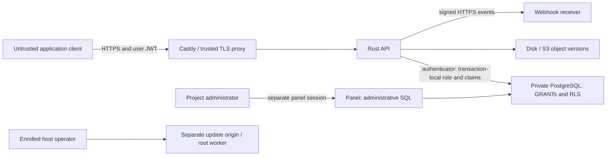

# Security model

Understand the trust boundaries before deploying Nelcota or granting access to
an application. You should know PostgreSQL GRANTs/RLS and control the deployment
host, TLS proxy and backup destination.

## Trust boundaries

Clients are untrusted. The API verifies the signature, expiry and allowed role
before setting transaction-local role/claims. Missing auth becomes `anon`;
invalid auth never silently becomes anonymous. PostgreSQL GRANTs and RLS decide
data access. SQL values are parameterized and identifiers are validated/quoted.
Internal credential, storage-control and webhook tables are not ordinary REST
resources. Limits and deadlines bound work; they do not make a public endpoint
immune to denial of service.

Project administrators are trusted with SQL and project data. Their session
is separate from end-user authentication. A host operator/root account controls
the machine, credentials and backups; compromise at that boundary is outside
what application RLS can contain. Controlled update authority requires separate
enrollment and an operator login; project SSO does not grant it.

## Your deployment responsibilities

- Keep PostgreSQL on a private network. The built-in connector uses `NoTls`;
  an `sslmode` URL alone does not supply a remote TLS connector. Do not expose
  the database across an untrusted network with this connector.
- Terminate HTTPS, secure DNS and firewall rules, and restrict direct access to
  the API behind your trusted proxy. With proxy trust enabled, Nelcota uses
  the rightmost `X-Forwarded-For` value; configure every proxy/CDN hop deliberately.
- Keep `service_role`, signing keys, `.env`, `host.env`, password hashes,
  refresh credentials and backups private. A service token bypasses RLS;
  it does not replace end-user authorization. Never ship one in frontend/mobile code.
- Give application roles only required GRANTs. Enable RLS and review `USING`
  and `WITH CHECK`. Owner views, `SECURITY DEFINER` functions, foreign tables
  and materialized views need explicit privilege review. Use invoker views when appropriate.
- Keep the host/container runtime and dependencies patched. Validate each
  upgrade on staging, including credentials, migrations, data and file continuity.
- Keep off-host database/file pairs and configuration secrets; test restoration.
  Database PITR does not restore object bytes to that timestamp. Set explicit
  provider retention/versioning and incomplete-multipart cleanup rules.
- Configure SMTP/OAuth redirect allowlists and protect client applications from
  XSS/CSRF. Browser session storage is readable by scripts on the application origin.
- Apply resource budgets and monitor overload. Auth quotas are per process,
  not a distributed IP limit; a CDN/proxy can add deployment-wide controls.

## Authentication and key rotation

Prefer Ed25519 keys generated with `nelcota keygen`. Do not reuse example
secrets. Built-in verification checks role/sub/expiry and signature; `iss` and
`aud` are informational, not enforced issuer/audience policies. Integrations
requiring those policies need their own verifier/middleware.

Logout/password recovery stops refresh. Already issued access JWTs remain valid
until expiry for ordinary API requests. Some sensitive auth operations additionally
check active sessions. Do not promise universal immediate revocation.

The built-in signer has one current Ed25519 key, not an overlapping key-rotation
service. Replacing it changes the published JWKS and rejects access tokens signed
by the old key after restart. Plan client/cache coordination and reauthentication.
HS256 can verify old HS256 tokens while Ed25519 signs; this is not an old-Ed25519
key ring. Store active keys and recovery configuration privately.

## Files and outbound effects

Storage applies object policies and restricts served content. Disk responses
include inert-content headers; S3 downloads redirect to a presigned provider URL.
Review the provider and any public-file proxy configuration, expiry, access logs
and content headers. Signed URLs are bearer credentials until they expire.

Webhook destinations require verified public HTTPS by default, with private
addresses/redirects blocked. Receivers get full changed rows, so configure only
trusted destinations. Verify the raw-body signature and timestamp, persist
deduplication by event ID, then acknowledge. Delivery is at least once and unordered.

## Operational limits

Controlled panel updates in `main` remain disabled until official artifacts
and exact-binary VPS acceptance pass. They do not certify your DNS, SSH rescue,
power-loss recovery or offsite restore. See [the operating guide](../panel-updates.md).

If you suspect compromise, isolate the affected credentials/host, preserve
private evidence, rotate keys and restore from a verified compatible pair as
appropriate. Do not post tokens, personal data or exploit details in public issues.
Report a suspected Nelcota vulnerability through [SECURITY.md](../../SECURITY.md).

Related: [JWT/roles](../jwt-and-roles.md), [storage](../storage.md),
[backup](../backup.md), [configuration](../configuration.md) and
[review summary](review-summary.md).
